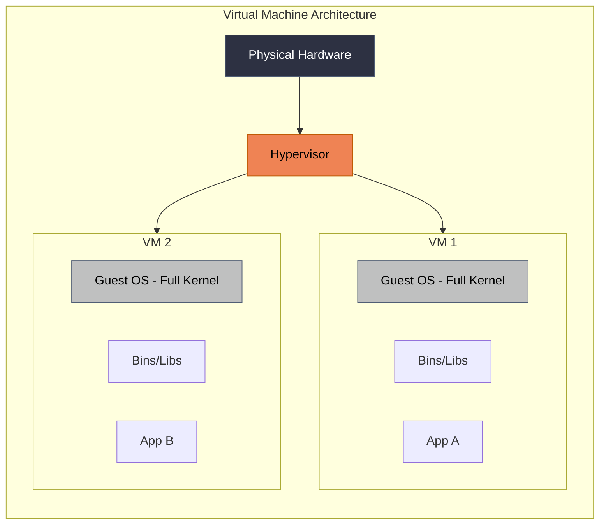
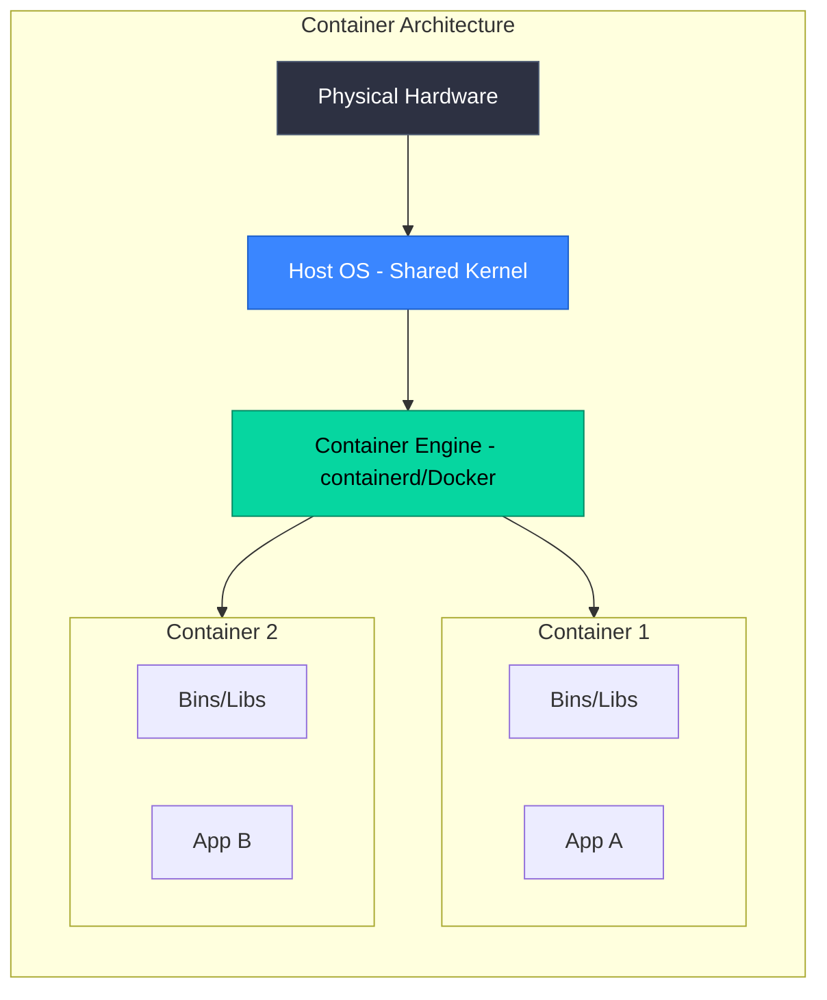
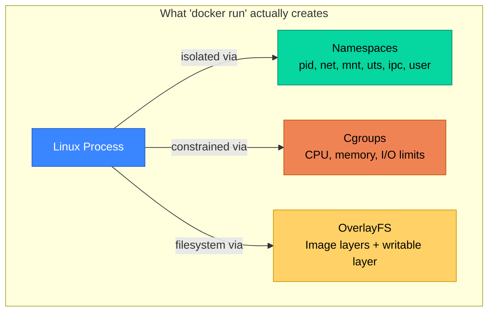
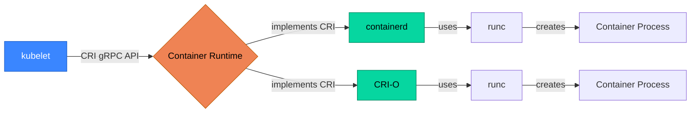
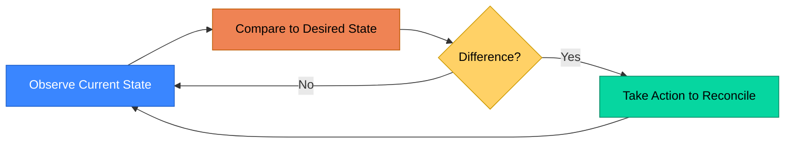
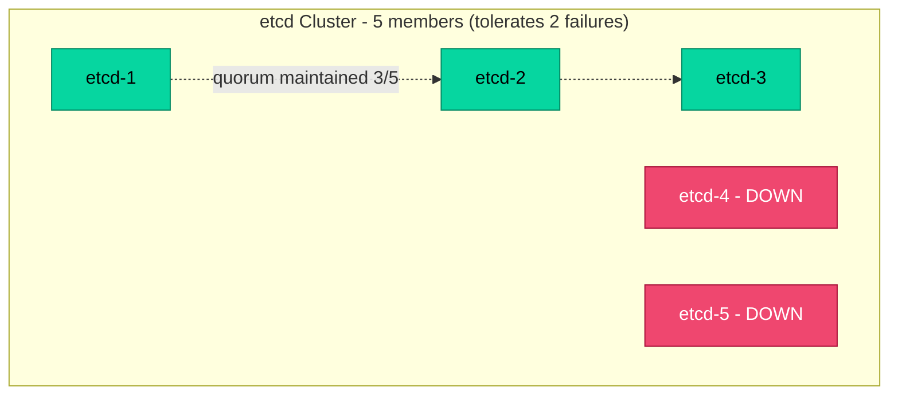
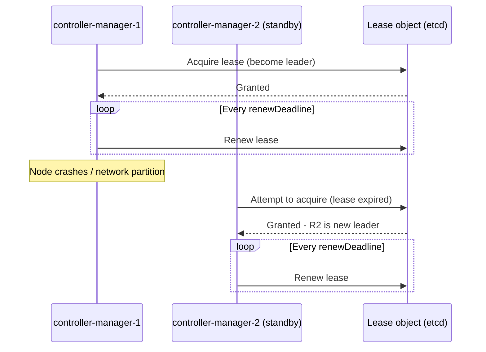

# Part 1: Foundations Before Kubernetes

> **Audience**: Engineers with basic Linux and Docker experience, starting from zero on distributed systems concepts.
> **Goal**: Understand *why* Kubernetes exists before learning *how* it works. Skipping this leads to cargo-culting YAML without judgment.

---

## 1.1 Why Kubernetes Exists

### 1.1.1 The Problem with Manual Deployments and VMs

Before container orchestration, a typical deployment workflow looked like this:

1. Provision a VM (physical or cloud).
2. SSH in, install runtime dependencies (Java, Python, Node, system libraries).
3. Copy application artifacts (JARs, scripts) onto the box.
4. Configure a process supervisor (systemd, supervisord) to keep it running.
5. Manually configure a load balancer to point at the VM's IP.
6. To scale, repeat steps 1–5 on a new VM and update the load balancer.

This works, but breaks down at scale because of several structural problems:

- **Configuration drift**: Two VMs that were "identically" provisioned six months apart rarely stay identical. Patches applied inconsistently, manual hotfixes never reverted — this is the classic "snowflake server" problem.
- **Slow, manual scaling**: Scaling requires a human (or a brittle script) to provision a new VM, configure it, and register it with the load balancer. This takes minutes to hours, not seconds.
- **Poor resource utilization**: A VM sized for an application's peak load sits mostly idle during normal operation. Multiple applications are rarely safely co-located on one VM because there's no resource isolation guarantee — a noisy neighbor process can starve others.
- **No self-healing**: If a process crashes or a VM dies, nothing brings it back automatically unless someone built custom tooling for it.
- **Deployment is risky and manual**: Rolling out a new version typically means SSHing into each box, often with custom shell scripts, with no standardized rollback mechanism.

Configuration management tools (Ansible, Chef, Puppet) emerged to address *provisioning* consistency, but they don't address *runtime* concerns — they don't watch your application and restart it if it dies, they don't reschedule work off a failed node, and they don't make bin-packing decisions about where to place workloads.

### 1.1.2 Containers vs VMs: A Systems-Level Comparison

The shift from VMs to containers is the precursor to Kubernetes. Understanding the architectural difference is essential.





| Aspect | Virtual Machine | Container |
|---|---|---|
| Isolation boundary | Hardware-level (hypervisor) | OS-level (kernel namespaces) |
| Kernel | Each VM has its own kernel | Shared host kernel |
| Boot time | Seconds to minutes | Milliseconds to seconds |
| Image size | GBs (full OS) | MBs to low GBs (app + deps only) |
| Density per host | Low (10s) | High (100s to 1000s) |
| Security isolation | Strong (separate kernel) | Weaker by default (shared kernel — requires hardening) |

The critical insight: **a container is just a regular Linux process with restricted visibility into the system**, achieved through kernel namespaces, with resource constraints enforced through cgroups. There is no "container runtime kernel" — it's the same kernel as the host. This is *why* containers start fast (no kernel boot) and why container security is fundamentally different from VM security (a kernel exploit can escape a container far more easily than it can escape a hypervisor boundary).

### 1.1.3 The Evolution from Docker Swarm/Mesos to Kubernetes

Docker solved the *packaging* problem (build once, run anywhere via images) but not the *orchestration* problem (where do containers run, how do they get rescheduled on failure, how do they discover each other). Three major orchestrators emerged around 2014–2015 to solve this:

- **Docker Swarm**: Docker's own orchestrator. Simple, tightly integrated with the Docker CLI, but limited in scheduling sophistication and ecosystem extensibility.
- **Apache Mesos** (with Marathon as the scheduler framework): A two-level scheduler originally built for big-data workloads (Hadoop/Spark) at Twitter, later adapted for general container orchestration. Powerful but operationally complex.
- **Kubernetes**: Released by Google in 2014, open-sourced from internal experience running **Borg** (Google's internal cluster manager, operating at massive scale since the mid-2000s) and its predecessor **Omega**.

Kubernetes won out for several reasons that matter for understanding its design philosophy:

1. **Declarative API as a first-class citizen**: Unlike Swarm's more imperative command style, Kubernetes was built around the idea that you declare *desired state* and a control loop continuously reconciles reality toward it (see 1.3.1).
2. **Extensibility via CRDs and the API machinery**: Kubernetes was designed so that *anyone* could define new resource types and controllers — this is why the ecosystem (Helm, Istio, Argo, Crossplane, Operators) exploded around it rather than around Swarm or Mesos.
3. **CNCF governance**: Donated to the Cloud Native Computing Foundation in 2015, giving it vendor-neutral governance that accelerated multi-cloud adoption (AWS EKS, GCP GKE, Azure AKS all converged on it).
4. **Borg pedigree**: It encoded over a decade of Google's operational lessons about scheduling, resource isolation, and failure handling into its core abstractions — most operators didn't have to rediscover these the hard way.

### 1.1.4 What "Orchestration" Actually Means

"Orchestration" is often used loosely. Precisely, a container orchestrator does the following jobs:

- **Scheduling**: Deciding *which* node in a cluster a given workload should run on, based on resource availability, constraints, and policies.
- **Service discovery**: Allowing workloads to find each other without hardcoded IPs, even as instances are created/destroyed/rescheduled.
- **Health management**: Detecting failed or unhealthy instances and replacing them automatically.
- **Scaling**: Adjusting the number of running instances based on load or policy.
- **Rollouts and rollbacks**: Managing the transition from one version of an application to another with minimal disruption.
- **Resource governance**: Enforcing CPU/memory limits so workloads don't starve each other, and packing workloads efficiently onto available hardware.
- **Configuration and secret distribution**: Getting the right configuration to the right workload instance securely.

Kubernetes does all of the above, but it's important to internalize that it does **not** do everything — it does not build your container images, it does not provide a CI pipeline, and out of the box it has limited opinions about networking, storage, and observability (these are pluggable via CNI, CSI, and the broader ecosystem, covered in later parts).

---

## 1.2 Container Fundamentals Refresher

Understanding Kubernetes deeply requires understanding what's actually happening underneath a "container" — this section is a fast but rigorous refresher.

### 1.2.1 Linux Primitives Behind Containers: Namespaces, Cgroups, Union Filesystems

Three independent Linux kernel features combine to create what we call a "container." None of them, individually, *is* a container — Docker (and later containerd, CRI-O) composed them into a coherent abstraction.

**Namespaces** provide *isolation* — they control what a process can *see*.

| Namespace | What it isolates |
|---|---|
| `pid` | Process IDs — container sees its own PID 1 |
| `net` | Network interfaces, routing tables, ports |
| `mnt` | Filesystem mount points |
| `uts` | Hostname and domain name |
| `ipc` | Inter-process communication (shared memory, semaphores) |
| `user` | UID/GID mappings (root inside ≠ root outside) |
| `cgroup` | Visibility of the cgroup hierarchy itself |

**Cgroups (control groups)** provide *resource limiting* — they control what a process can *use*.

- CPU shares/quotas (`cpu.cfs_quota_us`, `cpu.weight`)
- Memory limits (`memory.max`) — exceeding this triggers the OOM killer for that cgroup
- I/O bandwidth (`io.max`)
- PID count limits (preventing fork bombs)

Modern Kubernetes nodes use **cgroup v2** by default (a unified hierarchy, replacing the more fragmented cgroup v1), which is relevant when troubleshooting resource enforcement issues.

**Union/layered filesystems** (OverlayFS being the dominant implementation) provide *efficient image storage* — multiple read-only layers are stacked with a thin writable layer on top, so a 500MB base image can be shared across dozens of containers without duplication, and only the *delta* a container writes consumes additional space.



This is why `kubectl exec` into a container shows a process with PID 1 inside that container's `pid` namespace, but if you run `ps aux` on the *host* node, you'll see that same process with a completely different, much higher PID — it's the same process, just viewed through two different namespace lenses.

### 1.2.2 Image Layers, the OCI Spec, and Registries

The **Open Container Initiative (OCI)** defines two relevant specifications that ensure interoperability across the ecosystem (Docker, containerd, Podman, Kubernetes can all consume the same artifacts):

- **OCI Image Spec**: Defines the format of a container image — a manifest (JSON) referencing a config blob and an ordered list of filesystem layer blobs (each a tarball, typically gzip-compressed).
- **OCI Runtime Spec**: Defines how a compliant runtime (like `runc`) takes an unpacked filesystem bundle and a config file and actually executes it as a container, using the namespaces/cgroups primitives above.

A Docker image is conceptually:

```
manifest.json
  └── config.json (env vars, entrypoint, exposed ports, etc.)
  └── layer1.tar.gz (e.g., base OS layer)
  └── layer2.tar.gz (e.g., apt-get installed packages)
  └── layer3.tar.gz (e.g., your application code)
```

Each `RUN`, `COPY`, or `ADD` instruction in a Dockerfile typically creates a new layer. Layers are content-addressed (identified by a SHA256 hash of their contents), which is what allows registries and local caches to deduplicate identical layers across different images.

**Registries** (Docker Hub, GitHub Container Registry, AWS ECR, Google Artifact Registry, Harbor) store and serve these images via the **OCI Distribution Spec** (the HTTP API for push/pull). Kubernetes nodes pull images directly from registries via the container runtime — there's no Kubernetes-specific image format.

### 1.2.3 Container Runtimes: containerd, CRI-O, and the Container Runtime Interface (CRI)

Early Kubernetes (pre-1.20) talked directly to the Docker daemon via a Docker-specific shim called `dockershim`. This was architecturally awkward — Kubernetes had a generic concept of "run a container" but a hardcoded integration with one specific tool, while other runtimes (rkt, containerd, CRI-O) needed their own custom shims to integrate.

The **Container Runtime Interface (CRI)** was introduced to fix this: a gRPC API contract that the kubelet speaks, and *any* compliant runtime can implement, decoupling Kubernetes from any single runtime implementation.



- **`dockershim` removal**: Kubernetes 1.24 (April 2022) removed the built-in `dockershim`. This caused industry-wide concern ("Docker is being removed from Kubernetes!") but was mostly a non-event for users of managed Kubernetes (EKS/GKE/AKS) since they had already migrated to `containerd` as the default runtime. Note: this did **not** mean Docker-built images stopped working — OCI images built by Docker are still fully compatible; only the *daemon* integration changed.
- **containerd**: A graduated CNCF project, originally extracted from Docker itself, now the most widely used CRI-compliant runtime (default on EKS, GKE, AKS).
- **CRI-O**: Built specifically to be a minimal, Kubernetes-native CRI implementation (popular in OpenShift).
- **runc**: The low-level OCI Runtime Spec implementation that actually invokes the namespace/cgroup syscalls to spawn the container process. Both containerd and CRI-O use `runc` (or alternatives like `gVisor`/`Kata Containers` for stronger sandboxing) under the hood.

**Practical implication for troubleshooting**: when you run `crictl ps` on a node (instead of `docker ps`, which may not even be installed), you're talking to the CRI-compliant runtime directly — this is now the standard tool for node-level container debugging since `dockershim` removal (covered further in Part 18.2).

---

## 1.3 Core Distributed Systems Concepts

These concepts are the theoretical backbone of *every* design decision in Kubernetes. Understanding them prevents a common failure mode: memorizing kubectl commands without understanding *why* Kubernetes behaves the way it does under failure conditions.

### 1.3.1 Desired State vs Actual State (Control Loops)

This is the single most important concept in all of Kubernetes. Nearly every component is a variation on the same pattern:



This is called a **control loop** (or **reconciliation loop**), borrowed from control theory (think: a thermostat). You declare "I want 3 replicas of this Pod running" — that's *desired state*, stored in etcd. A controller continuously watches *actual state* (how many replica Pods currently exist and are healthy) and takes corrective action (create or delete Pods) whenever they diverge.

**Why this matters in practice**: this is why Kubernetes is resilient to partial failures in a way that imperative scripts are not. If a node dies taking 2 of your 3 replica Pods with it, no human or script needs to detect this and react — the ReplicaSet controller's reconciliation loop notices the actual state (1 running Pod) no longer matches desired state (3) and creates 2 replacement Pods, continuously, forever, without anyone calling a "fix it" script.

Every controller in Kubernetes — Deployments, StatefulSets, the kubelet itself, custom Operators — follows this exact pattern: **observe → diff → act → repeat**. Once this clicks, the entire system stops looking like a pile of YAML and starts looking like a set of independent feedback loops converging on a shared goal.

### 1.3.2 Eventual Consistency and Reconciliation

Kubernetes does not guarantee that desired state and actual state match at any given instant — it guarantees that the system will **converge** toward the desired state over time, assuming no further changes are made and the necessary resources/permissions exist. This is **eventual consistency**, not strong/immediate consistency.

Practical consequences:

- If you `kubectl apply` a Deployment, there is a window of time — milliseconds to seconds, sometimes longer under load — where the actual number of running Pods does not yet match the spec. This is normal, not a bug.
- If reconciliation *cannot* succeed (e.g., insufficient cluster resources, an image that doesn't exist, a PVC that can't bind), the controller does not give up — it retries indefinitely, typically with **exponential backoff**, while reporting the failure via events and status conditions. This is why `kubectl describe pod` and `kubectl get events` are the first troubleshooting move (Part 18.2) — the system will tell you *why* it can't converge.
- Multiple controllers reconcile independently and concurrently. A Deployment controller manages ReplicaSets; a ReplicaSet controller manages Pods; the scheduler assigns Pods to Nodes; the kubelet on each Node actually starts the containers. Each of these is its own independent control loop, watching only the resources relevant to it, communicating only through the shared API server/etcd state — not directly with each other.

### 1.3.3 CAP Theorem in the Context of Cluster State Stores

The **CAP theorem** states that a distributed data store can only guarantee two of the following three properties simultaneously during a network partition:

- **Consistency** (C): every read receives the most recent write or an error.
- **Availability** (A): every request receives a non-error response (not necessarily the most recent data).
- **Partition tolerance** (P): the system continues to operate despite network partitions between nodes.

Since network partitions are a fact of life in any real distributed system, **P is non-negotiable** — the actual tradeoff in practice is between **C and A** during a partition.

**etcd**, Kubernetes' cluster state store (covered in depth in Part 2.1), is a **CP system**: it prioritizes consistency over availability. etcd uses the **Raft consensus algorithm**, which requires a **quorum** (strict majority) of its members to agree before a write is committed. If enough etcd members become unreachable that quorum can't be formed, etcd will **refuse writes** (and often reads, depending on configuration) rather than risk serving stale or conflicting data.



**Why an odd number of etcd members matters**: quorum is calculated as `(N/2) + 1`. A 3-member cluster tolerates 1 failure (quorum = 2). A 5-member cluster tolerates 2 failures (quorum = 3). Critically, a **4-member cluster also only tolerates 1 failure** (quorum = 3) — adding a 4th member to a 3-member cluster *does not* improve fault tolerance, it only adds write latency (every write must be acknowledged by more members) and a (rare) increased risk of split votes. This is why production etcd clusters are virtually always sized at 3, 5, or 7 — never an even number.

**Practical implication**: when etcd loses quorum (e.g., during a botched upgrade, or losing 2 of 3 control plane nodes simultaneously), the Kubernetes API server can no longer reliably write — `kubectl apply` commands will hang or fail, though *already-running* workloads typically keep running fine (the kubelet doesn't need to talk to etcd directly; it talks to the API server, and existing Pods on healthy nodes are unaffected by a control-plane-only outage). This distinction — "control plane down" vs "workloads down" — is a frequent point of confusion and is revisited in Part 18 (etcd backup/restore, disaster recovery).

### 1.3.4 Leader Election and Split-Brain Scenarios

Several Kubernetes control plane components — most notably `kube-controller-manager` and `kube-scheduler` — are typically run with **multiple replicas for high availability**, but only **one replica is actively doing work at a time**. Running multiple active schedulers simultaneously, for example, could result in two different Pods being scheduled onto the same node thinking they each "won" the placement decision — a classic **split-brain** problem.

Kubernetes solves this using a **leader election** pattern built on top of the same `etcd`/API-server primitives:

1. Each replica attempts to acquire a `Lease` object (a lightweight Kubernetes API resource with a holder identity and renewal timestamp) in a well-known namespace.
2. Whichever replica successfully creates/updates the Lease first becomes the leader and must periodically **renew** the lease before it expires.
3. Standby replicas watch the Lease; if the leader fails to renew it within the configured timeout (it crashed, the node died, network partition), a standby replica acquires the lease and becomes the new leader.
4. Only the current leader performs actual reconciliation work; standbys are idle (hot standby), ready to take over within seconds.



This same leader-election pattern (via the `client-go` `leaderelection` package) is what most production-grade **custom Operators** use to safely run multiple replicas for HA without risking concurrent conflicting reconciliation — a detail directly relevant to Part 16 (building Operators for systems like sre-bot).

---

## Summary: What You Should Take Away From Part 1

- Kubernetes exists to solve orchestration problems (scheduling, healing, scaling, discovery) that VMs and manual processes solve poorly or not at all.
- A "container" is not a virtualization technology — it's a regular Linux process made to *look* isolated via namespaces, constrained via cgroups, and packaged via layered filesystems (OCI spec).
- The CRI decouples Kubernetes from any specific container runtime; containerd and CRI-O are the dominant implementations today.
- Nearly everything Kubernetes does is built on the **control loop pattern**: observe actual state, compare to desired state, act to reconcile, repeat — forever, independently, per-component.
- etcd is a CP (consistent, partition-tolerant) system using Raft consensus and quorum — this has direct, practical consequences for cluster sizing and disaster recovery.
- Leader election prevents split-brain in HA control plane components and is a reusable pattern for your own Operators.

**Next**: Part 2 takes these concepts and maps them onto the actual Kubernetes architecture — control plane components, node components, and the API request flow.
