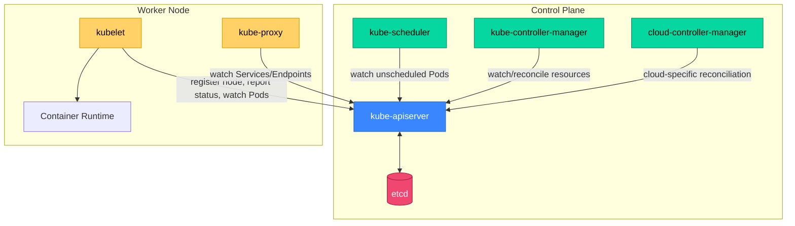
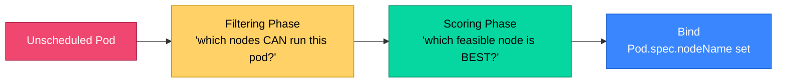
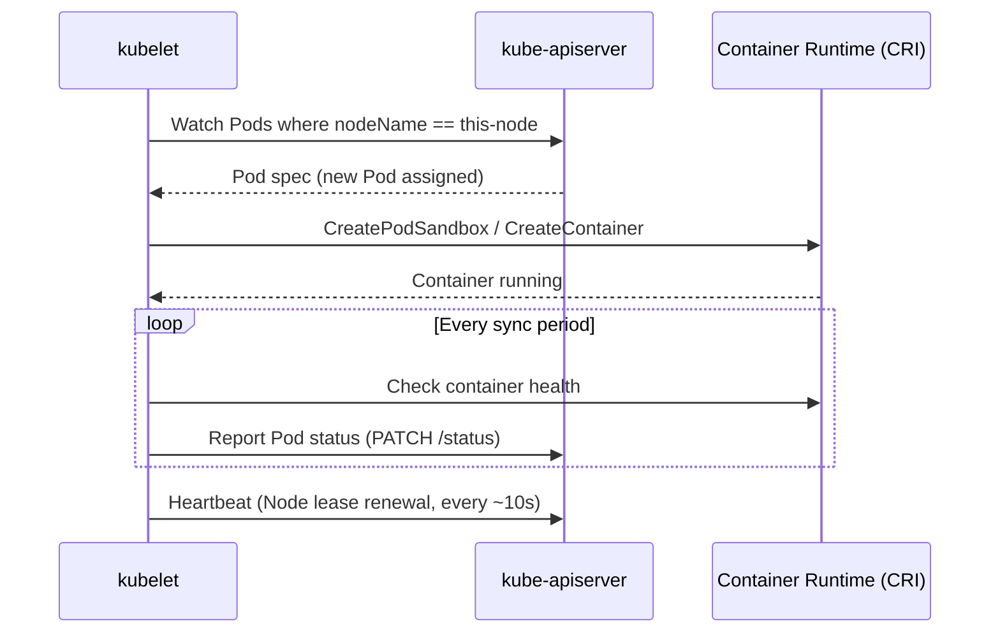
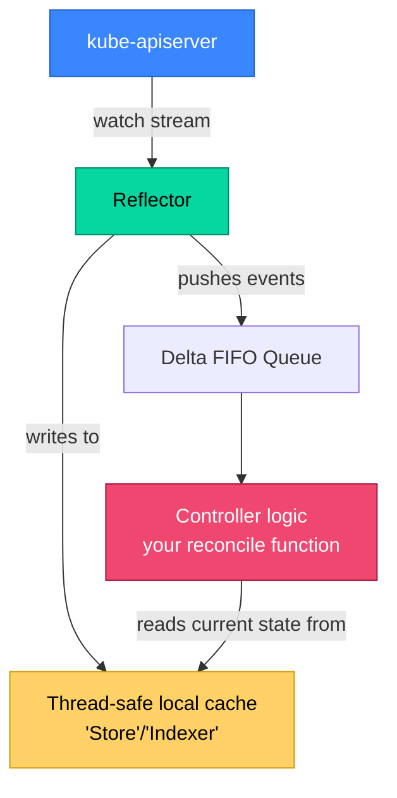

# Part 2: Kubernetes Architecture Deep Dive

> **Prerequisite**: Part 1 (control loops, CAP theorem, leader election).
> **Goal**: Understand every control plane and node component well enough to reason about failure modes, not just recite a diagram.

---

## 2.1 Control Plane Components

The control plane is the "brain" of a Kubernetes cluster — it makes global decisions (scheduling, responding to events) and maintains cluster state, but it does **not** run your application workloads directly (in standard production setups, control plane nodes are tainted to prevent regular Pods from scheduling there).



**Critical architectural rule**: every control plane component (and every node component) communicates with cluster state **only through the kube-apiserver**. No component talks directly to etcd except the API server. No component talks directly to another component's internal state. This single-entry-point design is what makes Kubernetes's RBAC, audit logging, and admission control universally enforceable — there's no backdoor path that bypasses the API server.

### 2.1.1 kube-apiserver: The System's Front Door

The API server is a stateless (mostly — see caching/watch caches below) HTTP/gRPC server exposing the Kubernetes REST API. Every `kubectl` command, every controller's watch, every kubelet heartbeat — all of it flows through here.

Key responsibilities:
- **Validates and processes REST requests** (CRUD on Kubernetes objects).
- **Serves as the only client of etcd** — translates API objects to/from etcd's key-value storage.
- **Implements the request pipeline**: authentication → authorization → admission control (detailed in 2.3.3).
- **Serves `watch` connections**: long-lived HTTP connections where clients (controllers, kubelet, kubectl) receive a stream of change events rather than polling.

Because it's "stateless" with respect to etcd as the source of truth, you can run **multiple replicas of kube-apiserver** behind a load balancer for HA — unlike the scheduler/controller-manager, there's no leader election needed here because API server replicas don't do conflicting work; they're just concurrent request handlers all reading/writing the same etcd backend.

```bash
# A typical HA control plane has 3 API server replicas behind an LB
# Verify which API server you're actually hitting (useful when debugging HA issues):
kubectl get --raw /healthz -v=8 2>&1 | grep "Trying"
```

### 2.1.2 etcd: Cluster State Store, Consistency Model, Backup/Restore

Covered conceptually in Part 1.3.3 (CAP theorem, Raft, quorum). Here we focus on operational mechanics.

**What's actually stored in etcd**: every Kubernetes object — Pods, Deployments, Secrets, ConfigMaps, every custom resource — is serialized (as protobuf by default, though JSON is supported) and stored under a key prefix, typically:

```
/registry/pods/<namespace>/<pod-name>
/registry/deployments/<namespace>/<deployment-name>
/registry/secrets/<namespace>/<secret-name>
```

This means **etcd is the single source of truth for the entire cluster's state**. Losing etcd without a backup means losing the cluster's entire configuration — though, importantly, *not* losing the actual running containers on healthy nodes (they keep running; you'd lose the ability to manage/reconcile them until etcd is restored).

**Backup**:

```bash
# Snapshot etcd (must be run with correct certs, typically on a control plane node)
ETCDCTL_API=3 etcdctl snapshot save /backup/etcd-snapshot-$(date +%Y%m%d-%H%M).db \
  --endpoints=https://127.0.0.1:2379 \
  --cacert=/etc/kubernetes/pki/etcd/ca.crt \
  --cert=/etc/kubernetes/pki/etcd/server.crt \
  --key=/etc/kubernetes/pki/etcd/server.key

# Verify the snapshot
ETCDCTL_API=3 etcdctl snapshot status /backup/etcd-snapshot-20260630-0300.db --write-out=table
```

**Restore** (high-level — full disaster recovery procedure is detailed in Part 18.1):

```bash
ETCDCTL_API=3 etcdctl snapshot restore /backup/etcd-snapshot-20260630-0300.db \
  --data-dir=/var/lib/etcd-restored \
  --name=etcd-restored \
  --initial-cluster=etcd-restored=https://127.0.0.1:2380 \
  --initial-advertise-peer-urls=https://127.0.0.1:2380
# Then update etcd's static pod manifest to point at the new data-dir and restart
```

**Production guidance**:
- Take etcd snapshots on a schedule (every few hours minimum for critical clusters) **and** before every cluster upgrade.
- etcd is latency-sensitive — it should run on fast local SSDs (NVMe ideally), never on slow network-attached storage, because Raft consensus requires fsync-ing writes to disk before acknowledging them.
- Managed Kubernetes (EKS, GKE, AKS) hides etcd entirely — you don't manage it, but understanding it is still essential for reasoning about API server latency, consistency guarantees, and certain failure modes (e.g., "why did my `kubectl apply` hang for 30 seconds").

### 2.1.3 kube-scheduler: Scheduling Algorithm, Predicates and Priorities

The scheduler's job, conceptually simple but algorithmically rich: for every Pod that exists in etcd with no `nodeName` assigned, decide which Node it should run on.

The scheduling decision happens in two phases, formalized by the **Scheduling Framework** (the current extensible architecture, replacing the older predicates/priorities terminology, though the underlying concepts are unchanged):



**Filtering** (formerly "predicates") eliminates infeasible nodes:
- Does the node have enough allocatable CPU/memory for the Pod's requests?
- Do the Pod's `nodeSelector`/`nodeAffinity` rules match this node's labels?
- Does the Pod tolerate this node's taints?
- Are there port conflicts (`hostPort`)?
- Does the Pod's PVC's volume topology constrain it to specific nodes (zone-locked storage)?

**Scoring** ranks the remaining feasible nodes (0–100 per plugin, then weighted-summed):
- `LeastAllocated` / `MostAllocated` (bin-packing strategy — pack tightly to allow scale-down, or spread out for resilience).
- `InterPodAffinity` scoring (prefer nodes co-locating affinity-matched pods).
- `ImageLocality` (prefer nodes that already have the container image cached, reducing pull time).
- Custom scoring plugins (Part 6.1 covers the Scheduling Framework extension points used to write these).

This filter-then-score model is important to internalize because it explains common scheduling confusion: a Pod can fail to schedule even with apparently "enough" total cluster CPU, because **filtering happens per-node** — five nodes each with 1 free CPU don't help a Pod that requests 2 CPUs, since no single node passes the filter.

### 2.1.4 kube-controller-manager and Built-in Controllers

This is a single binary that bundles **dozens of independent controllers**, each implementing the control-loop pattern from Part 1.3.1. Running them as one process (rather than dozens of separate binaries) reduces operational overhead, though each controller's reconciliation logic is logically independent.

Key built-in controllers:

| Controller | Responsibility |
|---|---|
| **Node controller** | Monitors node health (kubelet heartbeats); marks nodes `NotReady` and evicts Pods after timeout |
| **ReplicaSet controller** | Ensures the declared number of Pod replicas exist |
| **Deployment controller** | Manages ReplicaSets to implement rolling updates/rollbacks |
| **StatefulSet controller** | Manages ordered, identity-preserving Pod creation/deletion |
| **Job controller** | Tracks Job completions, applies backoff on failures |
| **Endpoint(Slice) controller** | Maintains the list of Pod IPs backing each Service |
| **Namespace controller** | Handles namespace deletion (garbage-collecting contained resources) |
| **ServiceAccount/Token controller** | Provisions default ServiceAccounts and their tokens |
| **GC controller** | Cleans up objects with no remaining owner references (Part 16.1) |

Each of these runs leader-elected (Part 1.3.4) when `kube-controller-manager` is deployed with multiple replicas for HA.

### 2.1.5 cloud-controller-manager

Cloud-specific logic (talking to AWS/GCP/Azure APIs) used to be compiled directly into `kube-controller-manager` and the kubelet. This tightly coupled the core Kubernetes codebase to every cloud provider's SDK — a maintenance and release-velocity problem. The **cloud-controller-manager (CCM)** was split out to isolate this:

- **Node controller (cloud-specific portion)**: initializes new Nodes with cloud-specific metadata (instance type, zone, region labels).
- **Route controller**: configures cloud network routes for Pod-to-Pod traffic where required (relevant for certain CNI setups).
- **Service controller**: provisions cloud load balancers when a `Service` of `type: LoadBalancer` is created.

On managed Kubernetes offerings, the CCM is operated by the provider and largely invisible to you — but understanding it explains *why*, for example, creating a `LoadBalancer` Service on EKS actually provisions a real AWS Network Load Balancer with a delay of tens of seconds, and why deleting that Service eventually deletes the cloud resource.

---

## 2.2 Node Components

### 2.2.1 kubelet and the Node Lifecycle

The kubelet is the primary "agent" running on every node. Critically: **the kubelet does not talk to other kubelets, and it does not talk directly to the scheduler or controller-manager.** It only watches the API server for Pods assigned to its node (`spec.nodeName == <this node>`) and ensures the containers described in those Pod specs are actually running, using the CRI to talk to containerd/CRI-O.



The kubelet also:
- Executes liveness/readiness/startup **probes** (Part 3.1.4) and restarts/marks-unready containers accordingly.
- Mounts volumes for Pods (interfacing with CSI drivers, Part 5.1.3).
- Reports node-level resource pressure (`MemoryPressure`, `DiskPressure`, `PIDPressure` conditions) used by the scheduler and eviction manager.
- Renews a **Node Lease** object roughly every 10 seconds as a lightweight heartbeat — if this lapses beyond `node-monitor-grace-period` (default 40s), the node controller marks the Node `NotReady`, and after a further `pod-eviction-timeout` (default 5m), begins evicting (rescheduling) its Pods elsewhere.

### 2.2.2 kube-proxy and Service Routing (iptables vs IPVS vs nftables)

`kube-proxy` implements the virtual IP mechanism behind Kubernetes `Service` objects (Part 4.2) — it watches Services and EndpointSlices and programs the node's networking stack so that traffic to a Service's stable ClusterIP gets load-balanced across the Service's actual backing Pod IPs, which change constantly as Pods are created/destroyed.

Three implementation modes exist, representing an evolution:

| Mode | Mechanism | Characteristics |
|---|---|---|
| **iptables** (long-time default) | Programs Linux `iptables` NAT rules, one chain of rules per Service | O(n) rule evaluation per packet as Service count grows — scaling issue at thousands of Services |
| **IPVS** | Uses the Linux kernel's IP Virtual Server (built for load balancing) | O(1) lookup via hash tables — far better at scale, supports more LB algorithms (round robin, least connection) |
| **nftables** (newer default trend) | Successor to iptables in the kernel itself | Better performance than legacy iptables, the direction the ecosystem is moving as iptables is deprecated in upstream kernel tooling |

**Practical implication**: at small-to-medium scale, the difference is rarely noticeable. At high Service counts (thousands), iptables mode's linear rule-matching becomes a measurable latency and CPU cost on every node — this is one of several reasons high-scale clusters often run **Cilium in kube-proxy replacement mode** (using eBPF instead of any of the above, bypassing kube-proxy entirely — covered in Part 4.1.3).

### 2.2.3 Container Runtime Integration

Already covered in depth in Part 1.2.3 (CRI, containerd, CRI-O, runc). The node-level summary: kubelet → CRI gRPC API → containerd/CRI-O → runc → actual container process via namespaces/cgroups.

---

## 2.3 The Kubernetes API

### 2.3.1 API Groups, Versions, and Resources

Every Kubernetes object is identified by a **GroupVersionResource (GVR)**:

```
apps/v1/deployments
batch/v1/jobs
networking.k8s.io/v1/networkpolicies
""/v1/pods          # the "core" group has an empty string as its group name
```

- **Group**: a logical namespace for related resources (`apps`, `batch`, `networking.k8s.io`). The legacy "core" group (pods, services, configmaps, secrets, nodes) has no group prefix.
- **Version**: API versions follow a maturity convention — `v1alpha1` (experimental, may change/break), `v1beta1` (more stable, still may have minor changes), `v1` (stable, backward-compatibility guaranteed).
- **Resource**: the plural, lowercase name used in URLs (`pods`, `deployments`).

```bash
# Discover what's actually available on a given cluster (varies by version/installed CRDs)
kubectl api-resources
kubectl api-versions
```

This GVR system is precisely what allows **Custom Resource Definitions (CRDs)** to feel like first-class Kubernetes objects (Part 16.1) — a CRD simply registers a new GVR with the API server, and `kubectl`, RBAC, and the watch/informer machinery all work with it identically to built-in types.

### 2.3.2 The Watch/Informer Pattern

Naive polling ("ask the API server every 5 seconds if anything changed") doesn't scale to thousands of controllers watching thousands of objects. Kubernetes instead uses a **watch** mechanism: a client opens a long-lived HTTP connection and the API server streams change events (`ADDED`, `MODIFIED`, `DELETED`) as they happen.

Building a controller directly on raw watch connections is error-prone (handling reconnects, resyncs, caching) so the standard `client-go` library provides the **Informer** pattern:



This is the foundational pattern underneath **every** controller and Operator (Part 16.1), including ones you'd write for `sre-bot` if it ever needs to react to Kubernetes events natively rather than polling. The Informer maintains a local, eventually-consistent cache, dramatically reducing load on the API server compared to every controller independently polling/listing.

**Minimal example using `client-go`** (Go, since that's your primary language for infra code):

```go
package main

import (
	"fmt"
	"time"

	v1 "k8s.io/api/core/v1"
	"k8s.io/client-go/informers"
	"k8s.io/client-go/kubernetes"
	"k8s.io/client-go/tools/cache"
	"k8s.io/client-go/tools/clientcmd"
)

func main() {
	config, err := clientcmd.BuildConfigFromFlags("", "/path/to/kubeconfig")
	if err != nil {
		panic(err)
	}
	clientset, err := kubernetes.NewForConfig(config)
	if err != nil {
		panic(err)
	}

	// Shared informer factory, resynced every 30s in addition to live watch events
	factory := informers.NewSharedInformerFactory(clientset, 30*time.Second)
	podInformer := factory.Core().V1().Pods().Informer()

	podInformer.AddEventHandler(cache.ResourceEventHandlerFuncs{
		AddFunc: func(obj interface{}) {
			pod := obj.(*v1.Pod)
			fmt.Printf("Pod ADDED: %s/%s\n", pod.Namespace, pod.Name)
		},
		UpdateFunc: func(oldObj, newObj interface{}) {
			pod := newObj.(*v1.Pod)
			fmt.Printf("Pod UPDATED: %s/%s phase=%s\n", pod.Namespace, pod.Name, pod.Status.Phase)
		},
		DeleteFunc: func(obj interface{}) {
			pod := obj.(*v1.Pod)
			fmt.Printf("Pod DELETED: %s/%s\n", pod.Namespace, pod.Name)
		},
	})

	stopCh := make(chan struct{})
	defer close(stopCh)
	factory.Start(stopCh)
	factory.WaitForCacheSync(stopCh)

	<-stopCh
}
```

### 2.3.3 API Server Request Flow: Authentication, Authorization, Admission Control

Every request to the API server passes through three sequential stages, and understanding their order is essential for debugging "why was my request rejected":

```mermaid
graph LR
    REQ[Incoming Request] --> AUTHN[1. Authentication<br/>Who are you?]
    AUTHN --> AUTHZ[2. Authorization<br/>Are you allowed?]
    AUTHZ --> ADM1[3a. Mutating Admission<br/>Modify the request]
    ADM1 --> SCHEMA[Schema Validation]
    SCHEMA --> ADM2[3b. Validating Admission<br/>Accept or reject]
    ADM2 --> ETCD[(Persist to etcd)]

    style REQ fill:#bfc0c0,stroke:#4f5d75,color:#000
    style AUTHN fill:#3a86ff,stroke:#1d5fc9,color:#fff
    style AUTHZ fill:#06d6a0,stroke:#048a64,color:#000
    style ADM1 fill:#ffd166,stroke:#cc9900,color:#000
    style ADM2 fill:#ef8354,stroke:#bf5b04,color:#000
    style ETCD fill:#ef476f,stroke:#a8123a,color:#fff
```



1. **Authentication**: establishes *identity*. Multiple methods can be configured simultaneously (client certs, bearer tokens, OIDC, webhook authenticators); the request is rejected with `401 Unauthorized` if none succeed. ServiceAccount tokens (JWTs) are the dominant in-cluster identity mechanism (Part 7.1.1).

2. **Authorization**: establishes *permission*. Given the authenticated identity, is this specific verb (get/list/create/update/delete) on this specific resource in this specific namespace allowed? RBAC is the standard mechanism (Part 7.1.2); rejection is `403 Forbidden`.

3. **Admission Control**: runs *after* authn/authz succeed, in two sequential sub-phases:
   - **Mutating admission webhooks**: can modify the request object (e.g., injecting a sidecar container — this is exactly how Istio's automatic sidecar injection and many policy-as-code defaulting mechanisms work).
   - **Validating admission webhooks**: can only accept or reject (cannot modify) — used for policy enforcement (OPA/Gatekeeper, Kyverno, Pod Security Admission — Part 7.2).

This ordering matters in practice: a request that's authenticated and authorized can still be **rejected by admission control** — a frequent source of confusion when a user has correct RBAC permissions but their `kubectl apply` still fails (e.g., Gatekeeper rejecting a Pod with no resource limits, or Pod Security Admission rejecting a privileged container).

### 2.3.4 API Deprecation Policy and Version Skew

Kubernetes has a formal **API deprecation policy**: once a GA (`v1`) API is released, it is supported for a minimum of 12 months *or* 3 minor releases (whichever is longer) before removal — but it can and will eventually be removed, which has caused real production incidents industry-wide (e.g., the `extensions/v1beta1` → `apps/v1` Deployment migration, or `policy/v1beta1` PodSecurityPolicy removal in 1.25).

```bash
# Check for usage of deprecated/removed APIs before upgrading — critical pre-upgrade step
kubectl get --raw /metrics | grep apiserver_requested_deprecated_apis

# Or use the dedicated tool:
# https://github.com/FairwindsOps/pluto
pluto detect-helm -owide
```

**Version skew policy**: components are not required to all run the identical version. The supported skew (as of recent Kubernetes releases) is:
- `kube-apiserver` replicas: can differ by 1 minor version during a rolling upgrade.
- `kubelet`: can be up to 3 minor versions older than `kube-apiserver` (this skew window was widened from 2 to 3 versions in newer Kubernetes releases specifically to give large fleets more upgrade flexibility).
- `kubectl`: can be 1 minor version newer or older than `kube-apiserver`.

This matters directly for Part 18.1 (cluster upgrade strategy) — you cannot, and should not, upgrade every component simultaneously; the skew policy is what makes a careful, sequenced rolling upgrade (control plane first, then nodes) both safe and necessary.

### 2.3.5 Server-Side Apply vs Client-Side Apply

`kubectl apply` historically worked by computing a three-way diff (last-applied-config annotation, current live object, new desired object) entirely on the **client side**, storing the entire last-applied configuration as a JSON annotation on the object. This caused real problems: annotation size limits, conflicting field ownership when multiple tools (Helm, `kubectl`, a controller) modified the same object, and unpredictable merge behavior.

**Server-Side Apply (SSA)**, GA since Kubernetes 1.22, moves this logic into the API server itself, introducing the concept of **field managers** and **field ownership**:

```bash
# Server-side apply explicitly
kubectl apply --server-side -f deployment.yaml

# See field ownership (which "manager" owns which field)
kubectl get deployment my-app -o yaml --show-managed-fields
```

With SSA, if two different actors (e.g., a GitOps controller and an HPA) both try to set the same field, the API server detects the **conflict** explicitly rather than silently overwriting — and requires an explicit `--force-conflicts` flag to resolve it. This is increasingly the default/recommended mode for GitOps tools like ArgoCD and is worth understanding deeply before Part 14, since field-ownership conflicts between a GitOps controller and an HPA/VPA mutating `replicas` or `resources` are a very common real-world gotcha.

---

## Summary: What You Should Take Away From Part 2

- All cluster components communicate exclusively through the API server — there is no direct etcd access, no direct component-to-component channel.
- etcd's Raft-based quorum requirement directly drives operational practices: odd-numbered clusters, fast disks, frequent backups.
- The scheduler's two-phase filter-then-score model explains many "why won't my Pod schedule" scenarios that aren't obvious from aggregate cluster capacity alone.
- `kube-controller-manager` bundles many independent control loops; `cloud-controller-manager` isolates cloud-specific logic.
- The kubelet only acts on Pods assigned to its own node — it has no cluster-wide visibility, by design.
- kube-proxy's iptables/IPVS/nftables modes represent an evolution toward better Service-routing performance at scale.
- Every API request flows through authentication → authorization → admission control, in that strict order — and any stage can independently reject a request.
- The watch/informer pattern is the foundational mechanism behind every controller and Operator you will ever build or operate.
- API deprecation and version skew policies are not academic — they directly shape safe upgrade procedures (Part 18.1).

**Next**: Part 3 moves from architecture into the workload objects you'll actually write YAML for daily — Pods, Deployments, StatefulSets, DaemonSets, Jobs, and disruption budgets.
