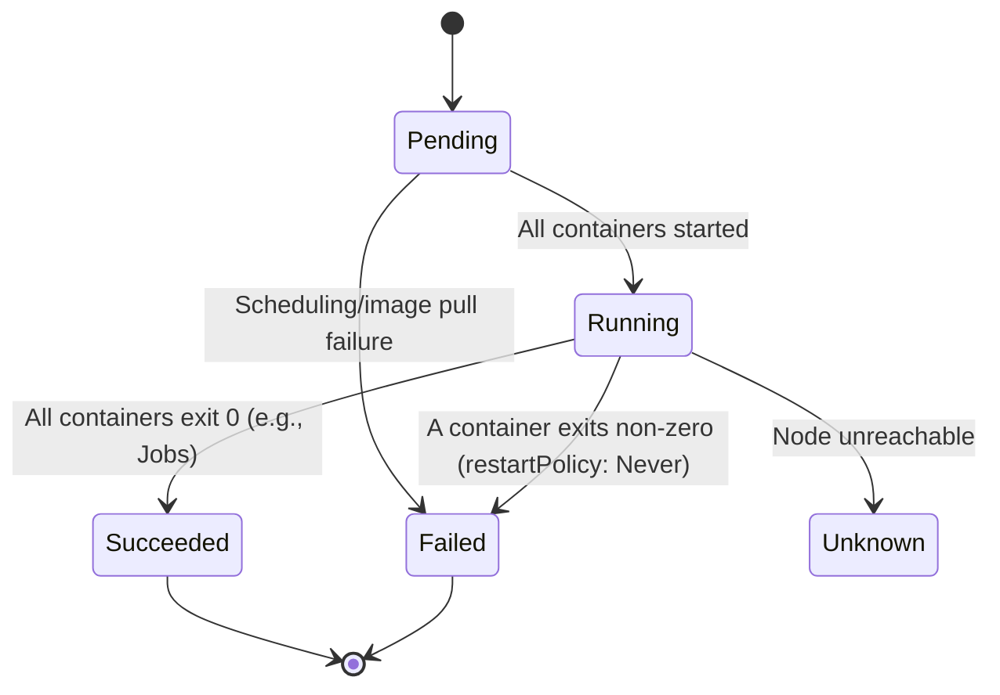
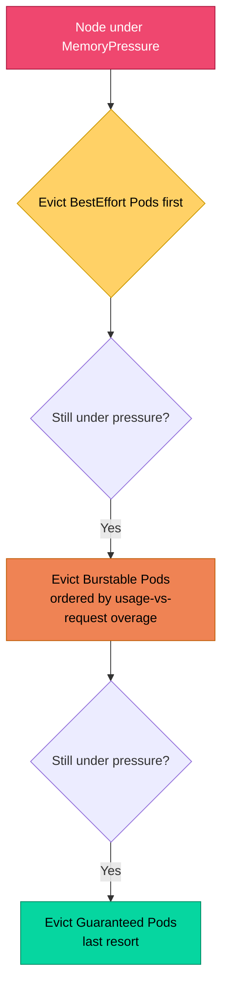
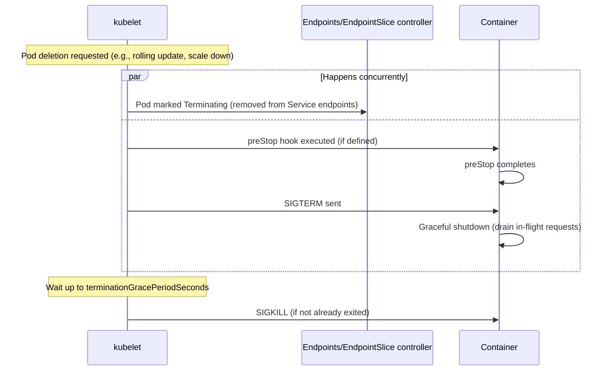
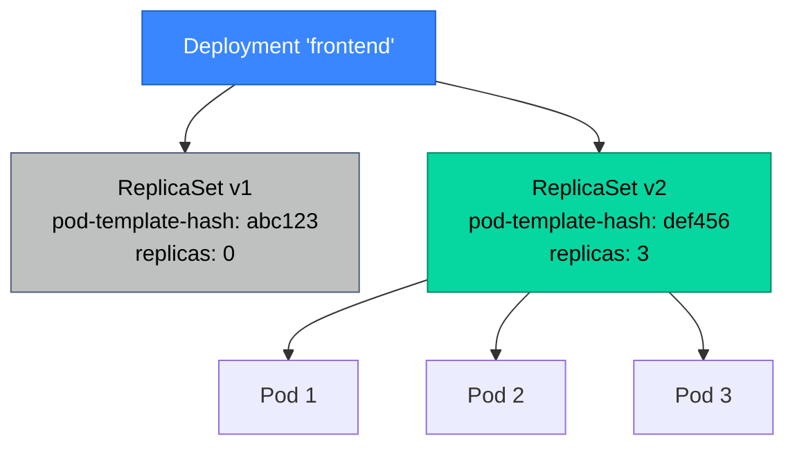
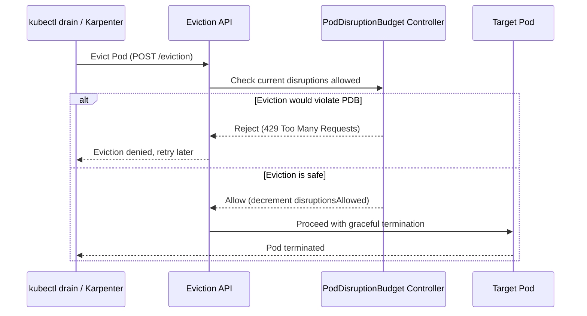

# Part 3: Core Workload Objects

> **Prerequisite**: Part 2 (scheduler, kubelet, API request flow).
> **Goal**: Master the objects you'll write and debug daily — with enough depth to understand *why* each design decision exists, not just the field names.

---

## 3.1 Pods

### 3.1.1 Pod Lifecycle and Phases

A Pod is the smallest deployable unit in Kubernetes — **not** a container, but a group of one or more containers that share network and storage namespaces. This is a deliberate design choice: containers in a Pod share the same network namespace (same IP, can reach each other via `localhost`), the same IPC namespace, and can share volumes — but each container still has its own filesystem (from its own image) and its own cgroup limits.

A Pod moves through a `status.phase`:



`Pending` covers a wide range of underlying states — unscheduled (no node assigned yet), scheduled but image still pulling, scheduled but waiting on volume mount. The phase alone is rarely enough for debugging; **conditions** (`PodScheduled`, `Initialized`, `ContainersReady`, `Ready`) and **container statuses** (`Waiting`/`Running`/`Terminated` with reasons) carry the actionable detail:

```bash
kubectl get pod my-pod -o jsonpath='{.status.conditions}' | jq
kubectl describe pod my-pod   # human-readable view of the same data, plus Events
```

### 3.1.2 Multi-Container Pods: Sidecars, Init Containers, Ephemeral Containers

**Init containers** run sequentially, to completion, *before* any regular container starts. Common uses: waiting for a dependency to be ready, running a one-time migration, fetching config/secrets into a shared volume.

```yaml
apiVersion: v1
kind: Pod
metadata:
  name: app-with-init
spec:
  initContainers:
    - name: wait-for-db
      image: busybox:1.36
      command: ['sh', '-c', 'until nc -z postgres.default.svc 5432; do sleep 2; done']
  containers:
    - name: app
      image: myapp:1.0
```

**Sidecar containers**: historically just "another regular container in the Pod" with no special lifecycle treatment. As of Kubernetes 1.29 (GA), **native sidecar support** lets you mark an `initContainer` with `restartPolicy: Always`, giving it sidecar semantics while still benefiting from init-container ordering guarantees — it starts before the main containers and keeps running alongside them, and crucially, Kubernetes now correctly handles sidecar shutdown ordering (sidecars terminate *after* main containers, not before — this fixed a long-standing pain point with service mesh proxy sidecars terminating early and breaking outbound traffic during Pod shutdown).

```yaml
spec:
  initContainers:
    - name: log-shipper-sidecar
      image: fluent-bit:latest
      restartPolicy: Always   # this makes it a native sidecar, not a blocking init container
      # ... runs for the lifetime of the Pod
  containers:
    - name: app
      image: myapp:1.0
```

**Ephemeral containers**: injected into an *already-running* Pod for debugging, without restarting it. They cannot have ports, resources, or probes, and can't be removed once added (the Pod must be deleted/recreated to remove them). This is the modern replacement for `kubectl exec`-ing into a minimal/distroless container that has no shell:

```bash
kubectl debug -it my-pod --image=busybox:1.36 --target=app-container
# Drops you into a new ephemeral container sharing the target's process namespace
```

### 3.1.3 Resource Requests/Limits and QoS Classes

```yaml
resources:
  requests:
    cpu: "250m"      # 250 millicores = 0.25 of one CPU core
    memory: "256Mi"
  limits:
    cpu: "500m"
    memory: "512Mi"
```

- **Requests** are what the scheduler uses for placement decisions — a node must have *allocatable* capacity ≥ the sum of requests of all Pods scheduled to it. Requests are also the value `cpu.shares`/`cpu.weight` is derived from for fair CPU time-slicing under contention.
- **Limits** are hard ceilings enforced by the kernel via cgroups. Exceeding a **memory** limit results in the container being OOM-killed (`SIGKILL`, status `OOMKilled`) — memory is *not* compressible, unlike CPU. Exceeding a **CPU** limit results in **throttling** (the process is paused for the remainder of the CFS scheduling period), not termination — a frequent source of confusing latency spikes that don't show up as crashes (revisited in Part 6.2.3).

Kubernetes derives a **Quality of Service (QoS) class** automatically from how requests/limits are set, and this class directly determines **eviction order under node memory pressure**:

| QoS Class | Condition | Eviction priority under pressure |
|---|---|---|
| `Guaranteed` | requests == limits for **every** container, for **both** CPU and memory | Evicted last |
| `Burstable` | At least one container has requests set, but not equal to limits (or limits unset) | Evicted second |
| `BestEffort` | No requests or limits set at all | Evicted first |



**Practical guidance**: critical stateful workloads (databases, message brokers) should run `Guaranteed` QoS. Stateless, horizontally-scalable web tier workloads are commonly `Burstable` (allowing some headroom above baseline). `BestEffort` should generally be avoided in production — it offers no protection during node pressure and signals "we didn't think about capacity for this workload."

### 3.1.4 Probes: Liveness, Readiness, Startup

| Probe | Question it answers | Failure action |
|---|---|---|
| **Liveness** | "Is this container still functioning, or stuck/deadlocked?" | kubelet kills and restarts the container |
| **Readiness** | "Is this container ready to receive traffic right now?" | Pod removed from Service Endpoints (no restart) |
| **Startup** | "Has this container finished its (possibly slow) initial startup?" | Disables liveness/readiness checks until it succeeds, preventing premature kills of slow-starting apps |

```yaml
livenessProbe:
  httpGet:
    path: /healthz
    port: 8080
  initialDelaySeconds: 5
  periodSeconds: 10
  failureThreshold: 3
readinessProbe:
  httpGet:
    path: /ready
    port: 8080
  periodSeconds: 5
  failureThreshold: 2
startupProbe:
  httpGet:
    path: /healthz
    port: 8080
  failureThreshold: 30   # allows up to 30 * periodSeconds for slow startup
  periodSeconds: 10
```

**Common production mistake**: using the *same* endpoint/logic for liveness and readiness. A liveness probe that checks downstream dependency health (e.g., "can I reach the database?") will cause the kubelet to **restart** the container every time the database has a transient blip — creating a cascading restart storm instead of just briefly removing the Pod from traffic (which is what readiness is for). Liveness should only check "is my own process responsive," not "are my dependencies healthy."

### 3.1.5 Pod Termination Lifecycle: SIGTERM, Grace Periods, preStop Hooks

Understanding Pod termination precisely is essential for zero-downtime deployments and is a frequent source of dropped requests during rollouts.



**The critical race condition**: removing the Pod from Service endpoints and sending `SIGTERM` happen **concurrently**, not sequentially — there is no guarantee that load balancers/kube-proxy have *finished* removing the Pod from rotation before `SIGTERM` arrives. This means a Pod can still receive new requests for a brief window *after* it starts shutting down. The standard mitigation is a `preStop` hook that sleeps briefly, giving the endpoint-removal propagation time to complete before the application actually starts terminating:

```yaml
lifecycle:
  preStop:
    exec:
      command: ["sh", "-c", "sleep 5"]
terminationGracePeriodSeconds: 30   # must be > preStop duration + actual graceful shutdown time
```

If the container hasn't exited by `terminationGracePeriodSeconds` after `SIGTERM`, the kubelet sends `SIGKILL` — abrupt, no further cleanup possible. This is precisely why PodDisruptionBudgets (3.5) and `terminationGracePeriodSeconds` tuning matter together for StatefulSets handling in-flight transactions or connections.

---

## 3.2 Controllers for Stateless Workloads

### 3.2.1 ReplicaSets

A ReplicaSet's sole job: ensure a specified number of Pod replicas matching a label selector are running at all times — the simplest direct implementation of the control loop pattern from Part 1.3.1. You will almost never create a ReplicaSet directly; Deployments manage them for you.

```yaml
apiVersion: apps/v1
kind: ReplicaSet
metadata:
  name: frontend-rs
spec:
  replicas: 3
  selector:
    matchLabels:
      app: frontend
  template:
    metadata:
      labels:
        app: frontend
    spec:
      containers:
        - name: frontend
          image: frontend:1.0
```

**Important gotcha**: the `selector` is immutable after creation and must match the Pod template's labels — and ReplicaSets will happily "adopt" *any* existing Pod matching the selector, even one it didn't create. This is exactly the mechanism Deployments use during rolling updates (new ReplicaSet, old ReplicaSet, both selecting disjoint label sets via a `pod-template-hash` label Kubernetes adds automatically).

### 3.2.2 Deployments: Rolling Updates, Rollbacks, Strategies

A Deployment manages ReplicaSets to provide declarative updates with history and rollback support. It does not manage Pods directly — Deployment → ReplicaSet → Pods, a two-level hierarchy.



When you update a Deployment's Pod template (e.g., new image tag), it creates a **new** ReplicaSet and orchestrates a transition according to its `strategy`:

```yaml
spec:
  replicas: 6
  strategy:
    type: RollingUpdate
    rollingUpdate:
      maxSurge: 25%        # how many EXTRA pods beyond replicas during rollout
      maxUnavailable: 25%  # how many of the desired pods can be unavailable during rollout
  minReadySeconds: 10      # a new pod must be Ready for this long before counted "available"
```

- `maxSurge` and `maxUnavailable` together govern rollout speed vs safety. `maxSurge: 0, maxUnavailable: 25%` does a strict "kill old, then create new" pattern (useful when you can't exceed your normal replica count due to resource quotas, but slower and briefly reduces capacity). `maxSurge: 25%, maxUnavailable: 0` never reduces available capacity but temporarily uses more cluster resources.
- The old ReplicaSet is **not deleted** after a successful rollout — it's scaled to 0 and retained (up to `spec.revisionHistoryLimit`, default 10), enabling instant rollback:

```bash
kubectl rollout history deployment/frontend
kubectl rollout undo deployment/frontend                    # roll back to previous revision
kubectl rollout undo deployment/frontend --to-revision=3     # roll back to specific revision
kubectl rollout status deployment/frontend                  # watch rollout progress, blocks until done/failed
```

`Recreate` strategy (the alternative to `RollingUpdate`) kills **all** old Pods before creating any new ones — used when the application cannot tolerate two versions running simultaneously (e.g., a non-backward-compatible schema migration coupled tightly to app version).

---

## 3.3 Controllers for Stateful and Specialized Workloads

### 3.3.1 StatefulSets: Stable Identity, Ordered Deployment, PVC Templates

StatefulSets exist because Deployments are fundamentally unsuited to workloads where **Pod identity matters** — databases, distributed consensus systems (etcd, Kafka, Zookeeper), anything where a replica needs a stable network identity and its *own* persistent storage that survives rescheduling.

Three guarantees a Deployment does not provide:

1. **Stable, predictable Pod names**: `myapp-0`, `myapp-1`, `myapp-2` — not random suffixes. On rescheduling, a replacement Pod gets the *same* name and ordinal.
2. **Stable network identity**: combined with a **headless Service** (`clusterIP: None`), each Pod gets a stable DNS name: `myapp-0.myapp-headless.default.svc.cluster.local`.
3. **Ordered, sequential deployment/scaling/termination** (by default): `myapp-0` must be `Running and Ready` before `myapp-1` is created; on scale-down, the highest ordinal terminates first.

```yaml
apiVersion: apps/v1
kind: StatefulSet
metadata:
  name: postgres
spec:
  serviceName: postgres-headless   # must reference a headless Service
  replicas: 3
  selector:
    matchLabels:
      app: postgres
  template:
    metadata:
      labels:
        app: postgres
    spec:
      containers:
        - name: postgres
          image: postgres:16
          volumeMounts:
            - name: data
              mountPath: /var/lib/postgresql/data
  volumeClaimTemplates:           # THIS is the key differentiator from Deployments
    - metadata:
        name: data
      spec:
        accessModes: ["ReadWriteOnce"]
        storageClassName: fast-ssd
        resources:
          requests:
            storage: 50Gi
---
apiVersion: v1
kind: Service
metadata:
  name: postgres-headless
spec:
  clusterIP: None
  selector:
    app: postgres
  ports:
    - port: 5432
```

`volumeClaimTemplates` is the critical mechanism: each Pod replica gets its **own** dedicated PersistentVolumeClaim (`data-postgres-0`, `data-postgres-1`, `data-postgres-2`), created automatically, and — critically — **these PVCs are NOT deleted when the StatefulSet is scaled down or the Pod is deleted**. This is intentional (data durability by default) but is a very common operational surprise: scaling a StatefulSet from 5 to 3 leaves 2 orphaned PVCs still consuming storage and billing, requiring manual cleanup if truly no longer needed.

```bash
# Orphaned PVCs after scale-down — these persist intentionally
kubectl get pvc -l app=postgres
```

**`podManagementPolicy: Parallel`** is available for StatefulSets where ordering doesn't matter but stable identity/storage still does (e.g., a distributed system that handles its own coordination), avoiding the slower sequential rollout.

### 3.3.2 DaemonSets

A DaemonSet ensures exactly one (or a constrained subset via node selectors) Pod replica runs on every eligible node — the standard pattern for node-level infrastructure: log shippers (Fluent Bit), metrics agents (node-exporter), CNI plugins, CSI node drivers.

```yaml
apiVersion: apps/v1
kind: DaemonSet
metadata:
  name: node-exporter
spec:
  selector:
    matchLabels:
      app: node-exporter
  template:
    metadata:
      labels:
        app: node-exporter
    spec:
      tolerations:                      # DaemonSets typically need to tolerate ALL taints
        - operator: Exists               # to ensure they run even on tainted/control-plane nodes
      containers:
        - name: node-exporter
          image: prom/node-exporter:latest
          resources:
            requests: {cpu: 50m, memory: 50Mi}
            limits: {cpu: 100m, memory: 100Mi}
```

DaemonSets bypass the scheduler's normal node-selection logic in a specific sense — they don't compete for "best" node via scoring; they simply target *every* node matching their node selector/affinity rules and tolerations. New nodes joining the cluster automatically get a DaemonSet Pod scheduled, without any reconfiguration.

### 3.3.3 Jobs and CronJobs

A **Job** runs Pods to completion (as opposed to Deployments, which run Pods indefinitely) — for batch processing, migrations, one-off tasks.

```yaml
apiVersion: batch/v1
kind: Job
metadata:
  name: db-migration
spec:
  completions: 1
  parallelism: 1
  backoffLimit: 4              # retries before marking the Job Failed
  activeDeadlineSeconds: 600   # overall timeout for the Job
  template:
    spec:
      restartPolicy: Never     # Jobs require Never or OnFailure, not Always
      containers:
        - name: migrate
          image: myapp-migrator:1.0
```

**CronJob** wraps a Job template with a schedule:

```yaml
apiVersion: batch/v1
kind: CronJob
metadata:
  name: nightly-cleanup
spec:
  schedule: "0 2 * * *"              # standard cron syntax, evaluated in the kube-controller-manager's timezone (or spec.timeZone if set)
  concurrencyPolicy: Forbid          # Allow | Forbid | Replace — what to do if previous run still active
  successfulJobsHistoryLimit: 3
  failedJobsHistoryLimit: 5
  jobTemplate:
    spec:
      template:
        spec:
          restartPolicy: OnFailure
          containers:
            - name: cleanup
              image: cleanup-job:1.0
```

### 3.3.4 Pod Failure Policies for Jobs (`backoffLimit`, `podFailurePolicy`)

By default, **every** Pod failure counts against `backoffLimit`, regardless of *why* it failed — including failures that retrying won't fix (e.g., a misconfigured Pod rejected by admission control) versus transient infrastructure issues (e.g., node preempted by the cluster autoscaler/Karpenter).

`podFailurePolicy` (GA since 1.31) lets a Job distinguish these cases explicitly:

```yaml
spec:
  backoffLimit: 6
  podFailurePolicy:
    rules:
      - action: FailJob                 # don't bother retrying — this failure is unrecoverable
        onExitCodes:
          containerName: migrate
          operator: In
          values: [2]                   # exit code 2 = "schema validation failed", a real bug
      - action: Ignore                  # don't count against backoffLimit at all
        onPodConditions:
          - type: DisruptionTarget      # pod was evicted due to node drain/preemption, not app failure
```

This matters significantly for production batch workloads running on **spot/preemptible nodes** (common with Karpenter consolidation, Part 6.3) — without `podFailurePolicy`, a Job can exhaust its `backoffLimit` and be marked permanently `Failed` purely from infrastructure-driven preemptions that had nothing to do with the actual workload's correctness.

---

## 3.4 Configuration and Secrets

### 3.4.1 ConfigMaps

```yaml
apiVersion: v1
kind: ConfigMap
metadata:
  name: app-config
data:
  LOG_LEVEL: "info"
  app.properties: |
    feature.flag.new_ui=true
    cache.ttl.seconds=300
```

Consumption patterns:

```yaml
containers:
  - name: app
    envFrom:
      - configMapRef:
          name: app-config        # every key becomes an env var
    volumeMounts:
      - name: config-volume
        mountPath: /etc/app/config
volumes:
  - name: config-volume
    configMap:
      name: app-config            # each key becomes a file in the mount path
```

### 3.4.2 Secrets: Native Limitations and External Secret Managers

Kubernetes Secrets are **base64-encoded, not encrypted**, by default — base64 is an encoding, not encryption, and is trivially reversible (`echo <value> | base64 -d`). This is the single most common Kubernetes security misconception among engineers new to the platform.

```bash
kubectl get secret db-credentials -o jsonpath='{.data.password}' | base64 -d
```

Mitigations, layered:

1. **Encryption at rest in etcd**: configure `EncryptionConfiguration` so the API server encrypts Secret data before writing to etcd (otherwise it's stored as base64-only in etcd's on-disk files — readable to anyone with etcd disk/snapshot access). Managed Kubernetes offerings typically enable this by default (e.g., via cloud KMS integration) but it's worth explicitly verifying, not assuming.
2. **RBAC restricting `get`/`list` on Secrets** to only the ServiceAccounts/users that genuinely need them (Part 7.1.2).
3. **External secret managers** (the production-grade answer): HashiCorp Vault, AWS Secrets Manager, GCP Secret Manager — combined with the **External Secrets Operator (ESO)**, which syncs secrets *from* these systems *into* native Kubernetes Secrets (or directly mounts them, bypassing etcd storage entirely with certain integrations), giving you centralized rotation, audit logging, and fine-grained access policies that native Secrets don't provide alone.

```yaml
# External Secrets Operator example — syncs from Vault into a native K8s Secret
apiVersion: external-secrets.io/v1beta1
kind: ExternalSecret
metadata:
  name: db-credentials
spec:
  secretStoreRef:
    name: vault-backend
    kind: SecretStore
  target:
    name: db-credentials           # the native Secret this creates/manages
  data:
    - secretKey: password
      remoteRef:
        key: secret/data/myapp/db
        property: password
```

This pattern is directly relevant to your sre-bot platform design — if sre-bot needs database/LLM API credentials, sourcing them via ESO from Vault rather than raw Kubernetes Secrets gives you rotation and audit trail for free.

### 3.4.3 Environment Variables vs Volume Mounts vs Projected Volumes

| Method | Update behavior | Use case |
|---|---|---|
| Env vars (`envFrom`/`env.valueFrom`) | **Static** — requires Pod restart to pick up changes | Simple, rarely-changing config |
| Volume mount (ConfigMap/Secret) | **Live-updated** (kubelet syncs periodically, ~1 min) without Pod restart — but the *application* must watch the file for changes itself | Config that should hot-reload, e.g., log level toggles |
| **Projected volumes** | Combine multiple sources (ConfigMap + Secret + ServiceAccount token + downward API) into one mount path | Apps needing config from several sources without multiple mount points cluttering the spec |

```yaml
volumes:
  - name: combined-config
    projected:
      sources:
        - configMap:
            name: app-config
        - secret:
            name: db-credentials
        - downwardAPI:
            items:
              - path: "pod-name"
                fieldRef:
                  fieldPath: metadata.name
```

### 3.4.4 Immutable ConfigMaps/Secrets and Rollout-Triggering Patterns

Marking a ConfigMap/Secret `immutable: true` prevents accidental mutation and — significantly — **reduces load on the API server**, since the kubelet no longer needs to watch it for changes (every mutable ConfigMap/Secret mounted as a volume is actively watched, which is a real, measurable cost at high cluster scale with many mounted ConfigMaps).

```yaml
apiVersion: v1
kind: ConfigMap
metadata:
  name: app-config-v3
immutable: true
data:
  LOG_LEVEL: "info"
```

Because immutable ConfigMaps can't be updated in place, the standard pattern is to **suffix the name with a content hash** (Helm's `configmap-checksum` annotation pattern, or Kustomize's built-in `configMapGenerator` hash suffixing) and update the Deployment to reference the new name — which naturally triggers a rolling update, since the Pod template changed:

```yaml
# kustomization.yaml
configMapGenerator:
  - name: app-config
    literals:
      - LOG_LEVEL=info
# Kustomize automatically appends a content hash: app-config-7d9fb47b2c
# and updates all references to it, ensuring a Deployment rollout on any config change
```

This solves the "I changed a ConfigMap but my running Pods didn't pick it up because env vars are static" problem cleanly and is the standard GitOps-compatible pattern (relevant again in Part 8.2 and Part 14).

---

## 3.5 Disruptions and Availability

### 3.5.1 Voluntary vs Involuntary Disruptions

Kubernetes formally distinguishes two categories of Pod disruption, and this distinction is the entire reason PodDisruptionBudgets exist:

- **Involuntary disruptions**: things that happen *to* you, outside Kubernetes' control — hardware failure, kernel panic, a cloud provider host failure, a node running out of resources triggering eviction. **PodDisruptionBudgets do not, and cannot, protect against these.** You handle involuntary disruption risk through replica count, anti-affinity (Part 6.1), and multi-zone spreading.
- **Voluntary disruptions**: actions initiated by an *administrator or automated controller* that Kubernetes can choose to delay or sequence safely — draining a node for maintenance, a cluster upgrade evicting Pods node-by-node, the Cluster Autoscaler or Karpenter consolidating/removing underutilized nodes. **This is exactly what PDBs govern.**

### 3.5.2 PodDisruptionBudgets: `minAvailable` vs `maxUnavailable`

A PodDisruptionBudget (PDB) declares a constraint that the **Eviction API** (used by `kubectl drain`, cluster autoscaler, Karpenter, and any well-behaved voluntary-disruption tooling) must respect before evicting a Pod matching the PDB's selector.

```yaml
apiVersion: policy/v1
kind: PodDisruptionBudget
metadata:
  name: frontend-pdb
spec:
  minAvailable: 2          # at least 2 must remain Ready at all times during voluntary disruption
  selector:
    matchLabels:
      app: frontend
```

```yaml
apiVersion: policy/v1
kind: PodDisruptionBudget
metadata:
  name: backend-pdb
spec:
  maxUnavailable: 1        # at most 1 may be unavailable at a time during voluntary disruption
  selector:
    matchLabels:
      app: backend
```

Use exactly **one** of `minAvailable` or `maxUnavailable` (never both — the API rejects this). `minAvailable` is generally preferred for workloads with a known minimum quorum/capacity requirement (e.g., "I need at least 2 of 3 etcd-like replicas for quorum"); `maxUnavailable` is generally preferred for elastic/horizontally-scaled workloads where you care about the *rate* of disruption relative to current size, not an absolute floor (`maxUnavailable: 10%` scales naturally as the Deployment scales).

### 3.5.3 How PDBs Interact with Node Drains and Autoscaler Scale-Down



The PDB controller continuously computes `status.disruptionsAllowed` based on current healthy replica count vs the budget. `kubectl drain` and cluster-scaling tools **retry with backoff** when an eviction is denied — they do not simply give up, but they also don't force through a PDB violation. This is precisely why a node drain can **hang indefinitely**: if a PDB requires `minAvailable: 3` for a Deployment that only has 3 replicas total, *no* voluntary eviction will ever be permitted, because evicting even one Pod would (temporarily) violate the budget.

### 3.5.4 PDB Pitfalls: Blocking Upgrades, Stuck Evictions, Single-Replica Traps

The most common production PDB misconfigurations, all worth recognizing on sight during peer review:

1. **`minAvailable: 100%` (or `minAvailable` equal to current replica count) on a Deployment**: mathematically guarantees zero voluntary disruption is ever possible — this will block every node drain and every cluster upgrade indefinitely, often discovered only during an actual maintenance window under time pressure.

   ```yaml
   # ANTI-PATTERN — replicas: 2, minAvailable: 2 — blocks ALL voluntary disruption forever
   spec:
     minAvailable: 2
     selector:
       matchLabels: {app: payments}
   ```

2. **Single-replica workloads with any PDB at all**: a PDB with `minAvailable: 1` on a single-replica Deployment has the same effect as case 1 — there's no room to evict even momentarily. If a workload genuinely can't tolerate any disruption, that's a signal to **increase replica count**, not to add a PDB that simply blocks all maintenance.

3. **PDB selector not matching the actual Pod labels** (e.g., after a label refactor) — silently provides *zero* protection (the PDB exists but governs zero Pods), discovered only when an unexpectedly disruptive drain takes down a workload that "should have" been protected.

4. **Forgetting PDBs entirely on StatefulSets with quorum requirements** (etcd-like, Kafka, Zookeeper-backed systems) — without a PDB, a node drain or Karpenter consolidation event can evict enough replicas simultaneously to break quorum, causing a real outage, even though each individual Pod would self-heal eventually. This is a very real risk for stateful platforms like `sre-bot`'s ClickHouse/Kafka pipeline if those are ever run with fewer replicas than their PDB accounts for.

**Practical guidance**: for any workload requiring N replicas for correctness/quorum (not just "nice to have capacity"), explicitly set `minAvailable: N` only if total replica count is *meaningfully greater* than N, so voluntary disruption still has room to operate. For purely elastic stateless tiers, prefer `maxUnavailable` expressed as a percentage.

### 3.5.5 Eviction API Mechanics

The Eviction API is a subresource (`/api/v1/namespaces/{ns}/pods/{name}/eviction`), distinct from a plain Pod `DELETE`. This distinction matters: a plain `kubectl delete pod` **bypasses PDB checks entirely** — only eviction-aware tooling (`kubectl drain`, the cluster autoscaler, Karpenter, descheduler) respects PDBs, because they go through the Eviction API specifically.

```bash
# This respects PDBs:
kubectl drain node-1 --ignore-daemonsets --delete-emptydir-data

# This does NOT respect PDBs (direct delete, not eviction):
kubectl delete pod my-pod
```

This is a frequent point of confusion during incident response: a PDB provides **zero** protection against a human (or a misbehaving script) directly deleting Pods — it only governs the specific, well-behaved voluntary-disruption code paths that explicitly use the Eviction API.

---

## Summary: What You Should Take Away From Part 3

- A Pod's termination involves a real race condition between endpoint removal and `SIGTERM` delivery — `preStop` sleeps are a standard, necessary mitigation, not a hack.
- QoS class (Guaranteed/Burstable/BestEffort) is derived automatically from requests/limits and directly determines eviction order under node pressure — set requests/limits deliberately, not as an afterthought.
- Liveness and readiness probes serve fundamentally different purposes; conflating them causes restart storms.
- StatefulSets exist specifically for workloads needing stable identity and per-replica persistent storage — and their PVCs intentionally outlive Pod/scale-down events.
- `podFailurePolicy` lets Jobs distinguish "real failure" from "infrastructure preemption," critical for batch workloads on spot/preemptible capacity.
- Native Kubernetes Secrets are base64-encoded, not encrypted — encryption-at-rest and external secret managers (Vault + External Secrets Operator) are the production-grade answer.
- PodDisruptionBudgets govern *voluntary* disruptions only, via the Eviction API specifically — and the most common production incident pattern is a PDB so strict it blocks all node drains/upgrades indefinitely.
