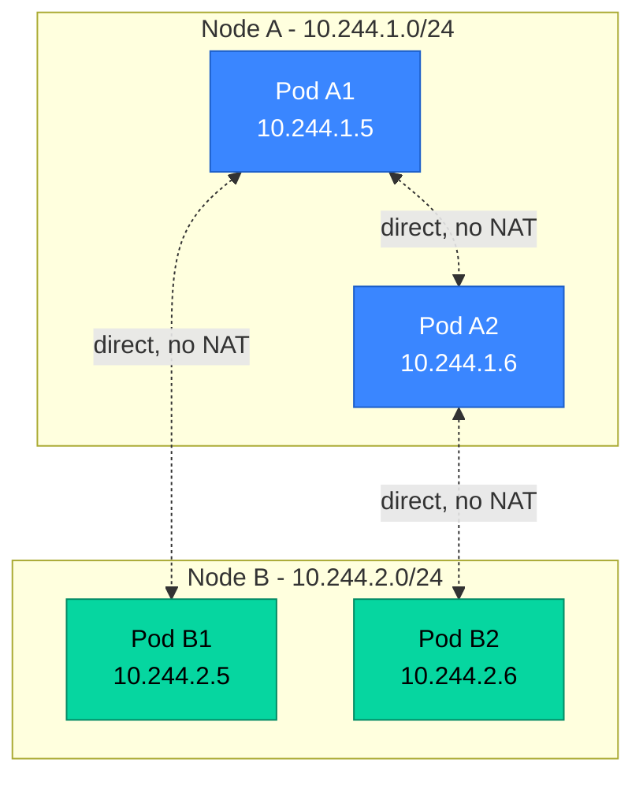
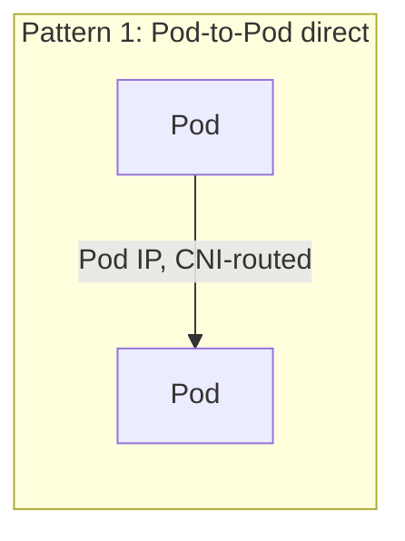
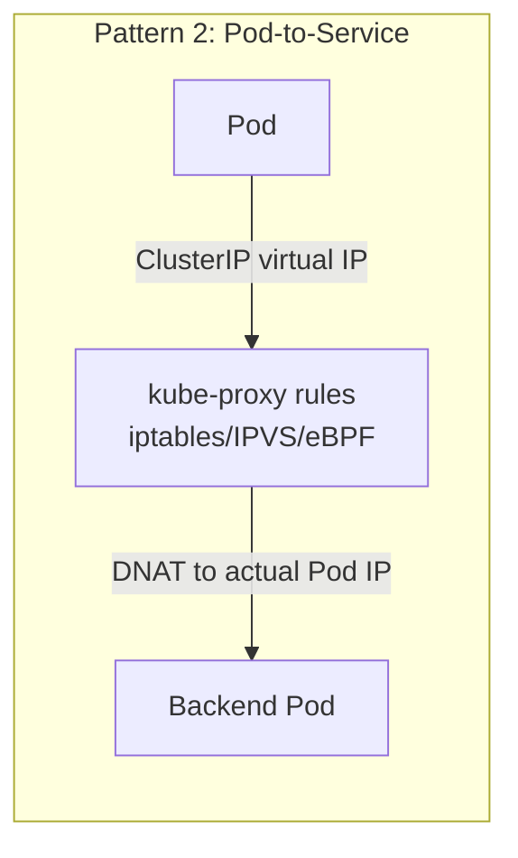
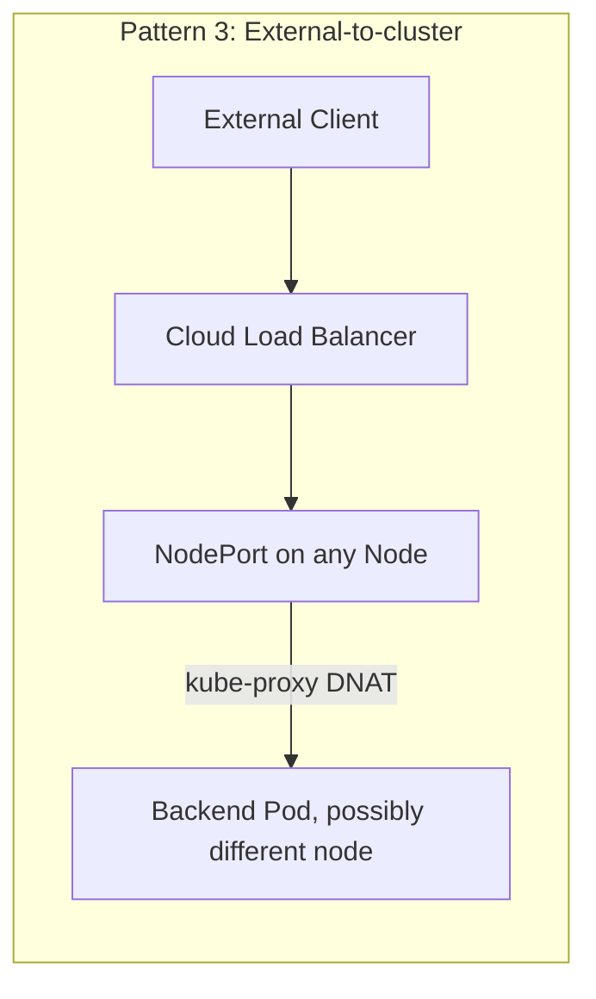
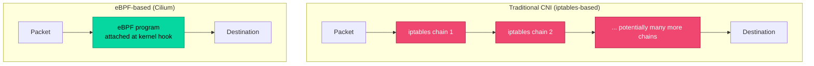
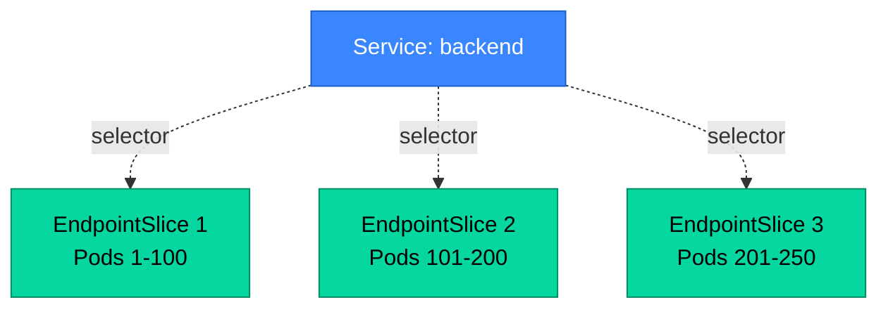
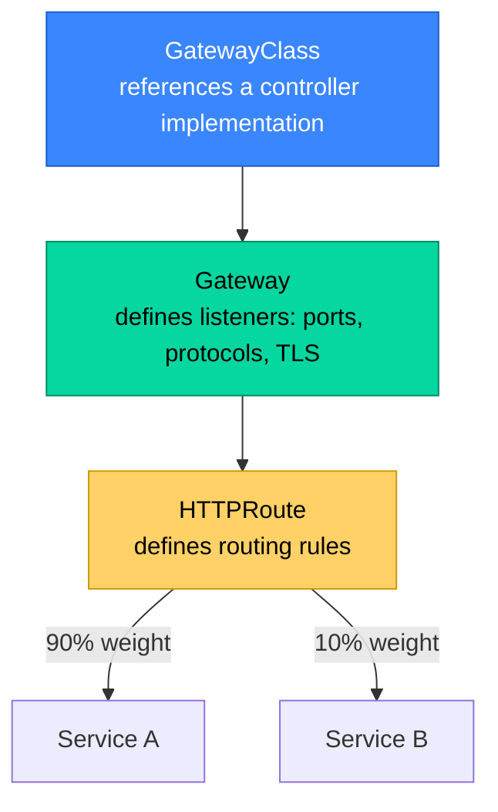

# Part 4: Networking

> **Prerequisite**: Part 2 (kube-proxy), Part 3 (Pods, controllers).
> **Goal**: Build a mental model precise enough to debug "why can't Pod A reach Pod B" from first principles, not guesswork.

---

## 4.1 Kubernetes Networking Model

### 4.1.1 The Flat Network Requirement

Kubernetes imposes a small set of fundamental networking requirements on any conformant cluster network implementation, regardless of which CNI plugin provides it:

1. **Every Pod gets its own unique IP address** ("IP-per-Pod" model) — no NAT between containers in the same Pod (they share a network namespace, hence share an IP), but every Pod across the entire cluster has a distinct, routable IP.
2. **Pods can communicate with all other Pods on any node without NAT.** A Pod on Node A must be able to reach a Pod on Node B using the target Pod's IP directly, with no address translation in between.
3. **Nodes can communicate with all Pods without NAT**, and vice versa.

This is a deliberately strong requirement — it's what makes Kubernetes networking feel like "one big flat network" regardless of how many physical nodes back it, and it's why application code never needs to know or care which node a peer Pod is running on.



Kubernetes itself does **not** implement this — it delegates entirely to the **CNI (Container Network Interface)** plugin. This is precisely analogous to the CRI split discussed in Part 1.2.3: Kubernetes defines the contract, plugins implement it, and the choice of implementation has real operational consequences (performance, policy enforcement capability, observability).

### 4.1.2 Pod-to-Pod, Pod-to-Service, and External Communication

Three distinct traffic patterns, each handled differently:







Pattern 2 is the one most worth internalizing precisely: a Service's `ClusterIP` is **not** assigned to any real network interface — it's a virtual address that exists only as DNAT rules programmed by kube-proxy (or eBPF rules, if using Cilium's kube-proxy replacement). Traffic to a ClusterIP never actually "arrives" at that IP in any conventional sense; it's rewritten in-flight to a real Pod IP before it ever leaves the source node (for most CNI/kube-proxy configurations).

### 4.1.3 CNI Plugins: Calico, Cilium, Flannel — Architectural Differences

| Plugin | Networking approach | Policy enforcement | Notable trait |
|---|---|---|---|
| **Flannel** | Simple overlay (VXLAN) | None natively (often paired with Calico for policy) | Simplest to operate, minimal feature set |
| **Calico** | Can run as pure L3 (BGP, no overlay) or VXLAN overlay | Rich NetworkPolicy (including non-namespaced GlobalNetworkPolicy) | Mature, widely used, strong policy engine |
| **Cilium** | eBPF-based — bypasses traditional iptables/netfilter entirely for most operations | L3/L4 standard NetworkPolicy **and** L7 (HTTP method/path, gRPC, Kafka topic-level) policy | Can fully replace kube-proxy; deep observability via Hubble |

**Why eBPF matters (Cilium specifically)**: traditional CNI implementations using iptables suffer the same O(n) rule-matching scaling problem discussed for kube-proxy in Part 2.2.2 — every packet potentially traverses a long chain of rules. **eBPF (extended Berkeley Packet Filter)** allows Cilium to attach small, verified programs directly to kernel hooks (e.g., at the network interface, or even at the socket layer), making per-packet decisions in-kernel without traversing iptables chains at all. This yields both better performance at scale and far richer observability (Hubble can show you, with no sidecar and minimal overhead, L7-aware flow logs of every connection in the cluster).



For your sre-bot platform — which is fundamentally an observability product — Cilium/Hubble is worth understanding deeply even beyond "which CNI to pick," since the eBPF-based flow visibility model is conceptually similar to what you're already doing at the application/metrics layer, just one layer lower in the stack (kernel-level network flows vs application-level Prometheus metrics).

---

## 4.2 Services

### 4.2.1 ClusterIP, NodePort, LoadBalancer, ExternalName

```yaml
apiVersion: v1
kind: Service
metadata:
  name: backend
spec:
  type: ClusterIP          # default — internal-only virtual IP
  selector:
    app: backend
  ports:
    - port: 80              # the Service's port
      targetPort: 8080      # the container's actual listening port
```

| Type | Behavior | Use case |
|---|---|---|
| `ClusterIP` | Stable virtual IP, cluster-internal only | Default for internal service-to-service communication |
| `NodePort` | Allocates a port (default range 30000–32767) on **every** node; traffic to `<any-node-ip>:<nodePort>` is forwarded to the Service | Rarely used directly in production; mostly a building block for `LoadBalancer` |
| `LoadBalancer` | Provisions a cloud load balancer (via cloud-controller-manager, Part 2.1.5) pointing at the Service | Standard way to expose a Service externally on cloud-managed Kubernetes |
| `ExternalName` | Pure DNS CNAME redirect — no proxying, no selector, no Endpoints | Referencing an external service (e.g., an RDS database) by an in-cluster-friendly DNS name |

`LoadBalancer` Services internally **build on top of** `NodePort` — a `LoadBalancer` Service is allocated a NodePort too, and the cloud LB simply forwards to `<node-ip>:<nodePort>` for every node, which kube-proxy then DNATs to an actual Pod (potentially on a *different* node — see `externalTrafficPolicy` below).

```yaml
apiVersion: v1
kind: Service
metadata:
  name: backend-external
spec:
  type: LoadBalancer
  externalTrafficPolicy: Local   # see 4.2.1.1 — preserves client source IP, avoids extra hop
  selector:
    app: backend
  ports:
    - port: 443
      targetPort: 8443
```

**`externalTrafficPolicy: Cluster` (default) vs `Local`**: `Cluster` allows traffic to any node to be forwarded to *any* backend Pod cluster-wide (potentially an extra network hop to a different node), but obscures the original client source IP (it's seen as the forwarding node's IP from the Pod's perspective). `Local` only forwards to Pods on the **same** node the traffic arrived at, preserving the real client source IP — at the cost of uneven load distribution if Pods aren't evenly spread across nodes, and the LB must correctly health-check per-node Pod presence.

### 4.2.2 Endpoints and EndpointSlices

A Service doesn't directly "contain" Pod IPs — a separate object tracks the actual backing Pod IPs and is what kube-proxy actually watches:

- **Endpoints** (legacy, singular object per Service): a single object holding *all* matching Pod IPs as one flat list. This does not scale well — a Service backing 5,000 Pods produces one enormous Endpoints object that every kube-proxy on every node must fully re-process on *any* single Pod change.
- **EndpointSlices** (current standard, GA since 1.21): the same data, but **sharded** into multiple smaller objects (default max 100 endpoints per slice), so a single Pod change only requires propagating a small delta, not the entire backend list.

```bash
kubectl get endpointslices -l kubernetes.io/service-name=backend
```



This is purely an internal scaling mechanism — you rarely interact with EndpointSlices directly, but understanding their existence explains why `kubectl get endpoints` sometimes shows surprisingly little detail on very large Services, and why propagation of Pod readiness changes to kube-proxy is fast even at scale.

### 4.2.3 Headless Services

Setting `clusterIP: None` produces a **headless Service** — no virtual IP is allocated at all. DNS queries against a headless Service return the **individual Pod IPs directly** (via multiple A/AAAA records) rather than a single load-balanced virtual IP.

```yaml
apiVersion: v1
kind: Service
metadata:
  name: postgres-headless
spec:
  clusterIP: None
  selector:
    app: postgres
  ports:
    - port: 5432
```

This is precisely the mechanism StatefulSets rely on (Part 3.3.1) for stable per-Pod DNS names — each Pod gets `<pod-name>.<headless-service-name>.<namespace>.svc.cluster.local`, letting clients address a *specific* replica (e.g., the primary in a database cluster) rather than being load-balanced to an arbitrary one.

### 4.2.4 Service Topology and Traffic Distribution (Topology-Aware Routing)

In multi-zone clusters, naive load balancing sends traffic to *any* matching Pod regardless of zone — incurring cross-zone data transfer costs (real money on every major cloud) and added latency. **Topology-aware routing** (the modern evolution of the older, now-removed "Topology Aware Hints" using `service.kubernetes.io/topology-mode: Auto`) biases endpoint selection to prefer same-zone backends when sufficient capacity exists there, falling back to cross-zone only when needed.

```yaml
apiVersion: v1
kind: Service
metadata:
  name: backend
  annotations:
    service.kubernetes.io/topology-mode: "Auto"
spec:
  selector:
    app: backend
  ports:
    - port: 80
```

This is a meaningful, often-overlooked cost lever — for a chatty microservices architecture spread across 3 AZs, cross-zone traffic charges can become a non-trivial portion of cloud spend, directly relevant to the FinOps material in Part 17.2.

### 4.2.5 Session Affinity

```yaml
spec:
  sessionAffinity: ClientIP
  sessionAffinityConfig:
    clientIP:
      timeoutSeconds: 10800   # 3 hours
```

`ClientIP` affinity makes kube-proxy route all requests from the same source IP to the same backend Pod for the configured timeout — a coarse, IP-based "sticky session" mechanism implemented at L3/L4. It does **not** understand cookies or any L7 concept of a session; many clients behind a single NAT'd IP (e.g., a corporate proxy) will all be pinned to the same backend Pod, which can cause uneven load distribution. For genuine L7 session affinity (cookie-based), this needs to be handled at the Ingress/Gateway layer instead (4.3) or by the application itself.

---

## 4.3 Ingress and Gateway API

### 4.3.1 Ingress Controllers (NGINX, Traefik)

A `Service` of type `LoadBalancer` provisions one cloud load balancer *per Service* — expensive and unwieldy when you have dozens of HTTP services needing external exposure. **Ingress** solves this: a single entry point (one or few cloud LBs) that routes based on HTTP host/path to many backend Services.

```yaml
apiVersion: networking.k8s.io/v1
kind: Ingress
metadata:
  name: app-ingress
  annotations:
    nginx.ingress.kubernetes.io/rewrite-target: /
spec:
  ingressClassName: nginx
  rules:
    - host: app.example.com
      http:
        paths:
          - path: /api
            pathType: Prefix
            backend:
              service:
                name: backend-svc
                port:
                  number: 80
          - path: /
            pathType: Prefix
            backend:
              service:
                name: frontend-svc
                port:
                  number: 80
  tls:
    - hosts: ["app.example.com"]
      secretName: app-tls-cert
```

The Ingress *object* is just a declaration — it does nothing by itself. An **Ingress controller** (a Pod/Deployment running in your cluster — NGINX Ingress Controller, Traefik, HAProxy Ingress, cloud-specific ones like AWS Load Balancer Controller) watches Ingress objects and configures itself (or provisions/configures a cloud ALB) accordingly. The single largest source of Ingress confusion: **the exact set of supported annotations and behaviors is controller-specific** — `nginx.ingress.kubernetes.io/*` annotations do nothing on Traefik, and vice versa. The core Ingress spec itself is intentionally minimal (host/path routing + TLS) precisely because it had to find a common denominator across very different proxy implementations.

### 4.3.2 The Gateway API as Ingress's Successor

The **Gateway API** (a separate, more expressive CRD-based API, GA since late 2023) was created specifically to address Ingress's limitations: no standard way to express L7 traffic splitting/weighting, header-based routing, or cross-namespace routing delegation without controller-specific annotations.



```yaml
apiVersion: gateway.networking.k8s.io/v1
kind: Gateway
metadata:
  name: shared-gateway
spec:
  gatewayClassName: nginx
  listeners:
    - name: https
      protocol: HTTPS
      port: 443
      tls:
        certificateRefs:
          - name: app-tls-cert
---
apiVersion: gateway.networking.k8s.io/v1
kind: HTTPRoute
metadata:
  name: canary-route
spec:
  parentRefs:
    - name: shared-gateway
  rules:
    - matches:
        - path: {type: PathPrefix, value: /}
      backendRefs:
        - name: backend-v1
          port: 80
          weight: 90
        - name: backend-v2
          port: 80
          weight: 10        # native weighted traffic splitting — no controller-specific annotations needed
```

The architectural split — `GatewayClass` (cluster-admin-managed, "which controller implementation") / `Gateway` (infra-team-managed, "the actual listener/LB") / `HTTPRoute` (application-team-managed, "my routing rules") — is a deliberate **role-oriented design**, letting platform teams own the Gateway while delegating HTTPRoute ownership to individual app teams safely via RBAC, without app teams needing any access to shared listener/TLS configuration. This role separation is directly useful for the multi-tenancy patterns discussed in Part 15.3.

### 4.3.3 TLS Termination Patterns

| Pattern | Where TLS ends | Tradeoff |
|---|---|---|
| **Edge termination** | At the Ingress/Gateway | Simplest; traffic is plaintext inside the cluster (acceptable if cluster network is trusted, or if a service mesh re-encrypts with mTLS internally) |
| **Passthrough** | TLS passed through unterminated to the backend Pod | Backend must handle TLS itself; needed when the LB shouldn't see plaintext at all (e.g., regulatory requirement, or non-HTTP protocols using SNI for routing) |
| **Re-encryption** | Terminated at edge, then **re-encrypted** for the hop to the backend | Strongest security posture; common when combined with a service mesh's automatic mTLS (Part 13.2) |

### 4.3.4 Cert-Manager and Automated Certificate Lifecycle

Manually provisioning and rotating TLS certificates does not scale. **cert-manager** automates issuance and renewal by watching `Certificate` resources and talking to a configured `Issuer`/`ClusterIssuer` (commonly Let's Encrypt via ACME, or an internal CA, or cloud-native certificate services).

```yaml
apiVersion: cert-manager.io/v1
kind: ClusterIssuer
metadata:
  name: letsencrypt-prod
spec:
  acme:
    server: https://acme-v02.api.letsencrypt.org/directory
    email: platform-team@example.com
    privateKeySecretRef:
      name: letsencrypt-prod-key
    solvers:
      - http01:
          ingress:
            ingressClassName: nginx
---
apiVersion: cert-manager.io/v1
kind: Certificate
metadata:
  name: app-tls-cert
spec:
  secretName: app-tls-cert          # the Secret cert-manager creates/maintains, referenced by Ingress/Gateway TLS config
  issuerRef:
    name: letsencrypt-prod
    kind: ClusterIssuer
  dnsNames:
    - app.example.com
  duration: 2160h                    # 90 days
  renewBefore: 360h                  # renew 15 days before expiry
```

cert-manager continuously reconciles (the control loop pattern again) — monitoring certificate expiry and automatically requesting renewal well before expiration, writing the resulting cert/key into the referenced Secret, which Ingress/Gateway TLS configs consume directly. This eliminates an entire historically common class of production incidents: expired certificates causing site-wide outages because a human forgot a manual renewal.

---

## 4.4 Network Policies

### 4.4.1 Default-Deny Patterns

**Critical fact**: by default, Kubernetes networking is **fully permissive** — any Pod can reach any other Pod across the entire cluster, regardless of namespace, unless a NetworkPolicy explicitly restricts it. This is the opposite of a secure-by-default posture, and is one of the first things a security-conscious platform team should address.

```yaml
# Default-deny ALL ingress traffic in a namespace — the standard starting point
apiVersion: networking.k8s.io/v1
kind: NetworkPolicy
metadata:
  name: default-deny-ingress
  namespace: production
spec:
  podSelector: {}              # empty selector = applies to ALL pods in the namespace
  policyTypes:
    - Ingress
```

Once a default-deny policy exists, you then layer **allow** policies on top for legitimate traffic flows — this "deny by default, allow explicitly" model is the only safe way to operate NetworkPolicy at scale; trying to enumerate every *deny* rule individually is unmaintainable.

### 4.4.2 L3/L4 Policy with NetworkPolicy

```yaml
apiVersion: networking.k8s.io/v1
kind: NetworkPolicy
metadata:
  name: allow-frontend-to-backend
  namespace: production
spec:
  podSelector:
    matchLabels:
      app: backend
  policyTypes:
    - Ingress
  ingress:
    - from:
        - podSelector:
            matchLabels:
              app: frontend
      ports:
        - protocol: TCP
          port: 8080
```

Standard NetworkPolicy operates at **L3 (IP) and L4 (port/protocol)** only — it can express "Pods labeled `app: frontend` may reach Pods labeled `app: backend` on TCP port 8080," but it has **no concept of HTTP paths, methods, or any application-layer semantics**. It also cannot express egress to specific external domains by name (only by IP/CIDR), which is a real limitation when restricting egress to, say, "only this specific third-party API."

```yaml
# Egress restricted to a specific CIDR (e.g., a managed database) plus DNS
apiVersion: networking.k8s.io/v1
kind: NetworkPolicy
metadata:
  name: backend-egress
  namespace: production
spec:
  podSelector:
    matchLabels:
      app: backend
  policyTypes:
    - Egress
  egress:
    - to:
        - ipBlock:
            cidr: 10.50.0.0/24    # e.g., RDS subnet
      ports:
        - protocol: TCP
          port: 5432
    - to:                          # DNS must be explicitly allowed or nothing will resolve
        - namespaceSelector: {}
          podSelector:
            matchLabels:
              k8s-app: kube-dns
      ports:
        - protocol: UDP
          port: 53
```

**Common gotcha**: forgetting to explicitly allow DNS egress (UDP/TCP 53 to CoreDNS) when applying an egress default-deny policy — this breaks *all* outbound connectivity for affected Pods, since they can no longer resolve any hostname at all, including in-cluster Service names, producing confusing "connection timeout" errors that are actually DNS failures in disguise.

### 4.4.3 L7 Policy with Cilium/Istio

For HTTP-method/path-level or gRPC-method-level policy, standard NetworkPolicy is insufficient — you need either Cilium's `CiliumNetworkPolicy` CRD (leveraging its eBPF L7 visibility) or a service mesh's authorization policies (Part 13.2):

```yaml
apiVersion: cilium.io/v2
kind: CiliumNetworkPolicy
metadata:
  name: backend-l7-policy
  namespace: production
spec:
  endpointSelector:
    matchLabels:
      app: backend
  ingress:
    - fromEndpoints:
        - matchLabels:
            app: frontend
      toPorts:
        - ports:
            - port: "8080"
              protocol: TCP
          rules:
            http:
              - method: "GET"
                path: "/api/v1/public/.*"
              - method: "POST"
                path: "/api/v1/orders"
```

This allows expressing policy like "the frontend may only `GET` from public read endpoints and `POST` to `/orders` specifically" — a meaningfully stronger security boundary than L3/L4 alone, directly relevant to zero-trust architectures (revisited in Part 7.3 and Part 13).

---

## 4.5 DNS in Kubernetes

### 4.5.1 CoreDNS Architecture

**CoreDNS** runs as a Deployment (typically 2+ replicas for HA) inside the cluster, exposed via its own ClusterIP Service (`kube-dns` by convention, despite the project being CoreDNS), and is configured via a `Corefile` (a ConfigMap) defining a plugin chain.

```
# Simplified default Corefile
.:53 {
    kubernetes cluster.local in-addr.arpa ip6.arpa {
        pods insecure
        fallthrough in-addr.arpa ip6.arpa
    }
    forward . /etc/resolv.conf    # non-cluster queries forwarded upstream
    cache 30
    loop
    reload
}
```

Every Pod's `/etc/resolv.conf` (injected by the kubelet) points `nameserver` at CoreDNS's ClusterIP by default, with a `search` path that enables short-name resolution within the cluster.

### 4.5.2 Service Discovery Resolution Paths

```
<service-name>.<namespace>.svc.cluster.local   →  A/AAAA record → Service ClusterIP
<pod-ip-dashed>.<namespace>.pod.cluster.local  →  A/AAAA record → Pod IP directly (less commonly used)
<pod-name>.<headless-svc>.<namespace>.svc.cluster.local  →  Individual Pod IP (StatefulSet pattern, 4.2.3)
```

The `search` domains in a Pod's `resolv.conf` (typically `<namespace>.svc.cluster.local`, `svc.cluster.local`, `cluster.local`, plus the node's own search domains) allow short-name resolution: from within the `production` namespace, simply querying `backend` resolves to `backend.production.svc.cluster.local` via search-path expansion, while `backend.staging` resolves cross-namespace explicitly.

### 4.5.3 Cross-Namespace DNS Troubleshooting

```bash
# Standard first debugging step — run a transient debug pod with DNS tools
kubectl run -it --rm dns-debug --image=nicolaka/netshoot --restart=Never -- bash

# Inside it:
nslookup backend.production.svc.cluster.local
cat /etc/resolv.conf
nslookup kubernetes.default     # sanity check that CoreDNS itself is reachable at all
```

Common root causes when DNS resolution fails:
- **NetworkPolicy blocking egress to CoreDNS** (the gotcha from 4.4.2).
- **CoreDNS Pods unhealthy/under-resourced** — check `kubectl get pods -n kube-system -l k8s-app=kube-dns` and CoreDNS's own metrics/logs for errors or throttling.
- **Wrong namespace assumed in a short name** — `backend` without a namespace suffix only resolves correctly from within `backend`'s own namespace due to search-path expansion; a Pod in a different namespace needs the fully-qualified or namespace-suffixed name.

### 4.5.4 DNS Performance Issues (ndots, Query Storms)

The default `ndots:5` setting in Kubernetes Pods' `resolv.conf` is a frequent, often invisible performance problem. It means: "if a hostname has fewer than 5 dots in it, try every search domain *before* trying it as an absolute name." For an application making an external API call to, say, `api.stripe.com` (2 dots, less than `ndots:5`), the resolver will first attempt:

```
api.stripe.com.production.svc.cluster.local   (fails, NXDOMAIN)
api.stripe.com.svc.cluster.local               (fails, NXDOMAIN)
api.stripe.com.cluster.local                   (fails, NXDOMAIN)
api.stripe.com.<node-search-domain>            (fails, NXDOMAIN)
api.stripe.com                                  (finally succeeds)
```

That's **5 DNS queries for every single external API call**, each adding latency and CoreDNS load — multiplied across every Pod making external calls, this becomes a measurable, sometimes severe, source of both latency and CoreDNS query-volume problems ("DNS query storms") at scale.

Mitigations:

```yaml
# Option 1: explicitly mark external-only hostnames as absolute (trailing dot) — bypasses search expansion
# Application-level: request "api.stripe.com." with trailing dot

# Option 2: tune ndots per-Pod when external calls dominate
spec:
  dnsConfig:
    options:
      - name: ndots
        value: "1"     # reduces search-path attempts for external-heavy workloads
```

```yaml
# Option 3 (cluster-wide mitigation): run NodeLocal DNSCache
# A DaemonSet running a local caching DNS resolver on each node, reducing CoreDNS query volume
# and avoiding the iptables/conntrack overhead of ClusterIP DNS routing entirely for cache hits
```

**NodeLocal DNSCache** is the standard production-scale mitigation: a DaemonSet runs a caching resolver on each node (listening on a link-local IP), Pods are configured to query it directly rather than CoreDNS's ClusterIP, dramatically reducing both query latency (cache hits avoid the network hop and conntrack table entry entirely) and load on the central CoreDNS Deployment.

---

## 4.6 Multi-Cluster Networking

### 4.6.1 Cluster Federation Concepts

As organizations grow beyond a single cluster (for blast-radius isolation, regulatory data residency, or simply scale beyond what's comfortable in one cluster), the question of cross-cluster service discovery and connectivity arises. The original **Kubernetes Cluster Federation (KubeFed)** project attempted a centralized "federate everything" API but saw limited production adoption due to complexity; the more common current approaches are narrower and more pragmatic:

- **Multi-cluster Services API** (`ServiceExport`/`ServiceImport`, an emerging standard supported by GKE, Cilium ClusterMesh, and others): explicitly export a Service from one cluster to be discoverable/reachable from others, rather than federating all cluster state.
- **Mesh-based multi-cluster** (Istio multi-cluster, Cilium ClusterMesh): extend the data-plane's service discovery and mTLS identity across cluster boundaries, treating multiple clusters as one logical mesh.

### 4.6.2 Multi-Cluster Service Discovery (Submariner, Istio Multi-Cluster)

**Submariner** establishes secure tunnels (typically IPsec or WireGuard) between clusters' Pod/Service CIDRs, plus a "Lighthouse" DNS component enabling cross-cluster Service resolution via a `.clusterset.local` suffix:

```bash
# Conceptual flow, not literal commands — Submariner is typically installed via subctl
subctl deploy-broker
subctl join --kubeconfig cluster-a-kubeconfig broker-info.subm
subctl join --kubeconfig cluster-b-kubeconfig broker-info.subm
# After join, a Pod in cluster-a can resolve:
# backend.production.svc.clusterset.local → routes across the tunnel to cluster-b
```

**Istio multi-cluster** (covered in depth in Part 13) takes a different approach — rather than a generic network tunnel, it extends the mesh's own east-west gateway and shared trust domain (shared root CA for mTLS) across clusters, so cross-cluster calls look identical to in-mesh calls from the application's perspective, complete with mTLS, retries, and observability.

The architectural choice here — generic network-layer federation (Submariner) vs mesh-layer federation (Istio) — typically follows from whether you're already committed to a service mesh: if you are, mesh-native multi-cluster avoids running two separate cross-cluster connectivity systems; if you're not running a mesh, Submariner-style tunneling is a lighter-weight option.

---

## Summary: What You Should Take Away From Part 4

- Kubernetes defines a *requirement* (flat, NAT-less Pod network) but delegates *implementation* entirely to CNI plugins — the choice between Flannel/Calico/Cilium has real performance and policy-capability consequences, not just operational preference.
- A ClusterIP is virtual, not a real interface — understanding the DNAT rewrite (via iptables, IPVS, or eBPF) demystifies most "why can't this reach that Service" debugging.
- EndpointSlices exist purely as a scaling mechanism over the older Endpoints object — sharding backend lists so large Services don't create single giant objects.
- Ingress is annotation-fragmented across controller implementations by design (minimal common spec); the Gateway API's role-oriented split (GatewayClass/Gateway/HTTPRoute) is the deliberate, more expressive successor.
- Kubernetes networking is permissive by default — default-deny NetworkPolicies are a baseline security practice, not an edge case, and forgetting explicit DNS-egress allowances is the most common self-inflicted outage when adopting them.
- `ndots:5` and its associated 5x DNS query multiplication for external calls is a frequently invisible performance tax at scale; NodeLocal DNSCache is the standard production mitigation.
- Multi-cluster networking splits into network-layer (Submariner) vs mesh-layer (Istio multi-cluster) federation approaches, with the right choice largely determined by whether a service mesh is already in play.

**Next**: Part 5 covers Storage — PersistentVolumes, the CSI, access modes, and the storage patterns that StatefulSets (Part 3.3.1) depend on.
