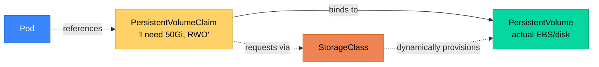
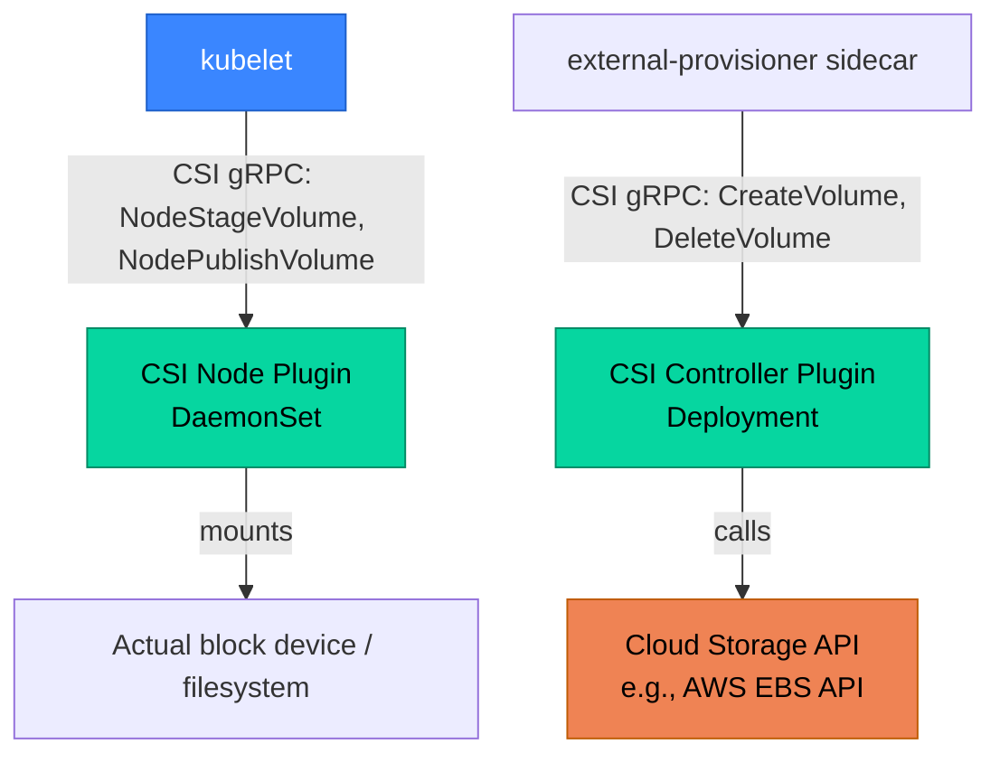
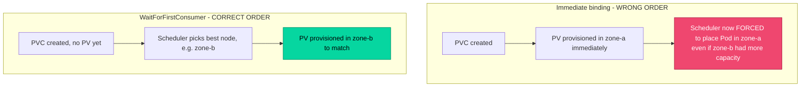

# Part 5: Storage

> **Prerequisite**: Part 3.3.1 (StatefulSets and `volumeClaimTemplates`).
> **Goal**: Understand the PV/PVC abstraction layer deeply enough to reason about binding, topology, and snapshot/recovery workflows.

---

## 5.1 Storage Primitives

### 5.1.1 Volumes vs PersistentVolumes vs PersistentVolumeClaims

These three terms are frequently conflated by newcomers but represent distinct concepts:

- **Volume** (the generic Pod-spec-level concept): any of dozens of volume *types* a Pod can mount — `emptyDir`, `configMap`, `secret`, `hostPath`, `projected`, and also `persistentVolumeClaim` (a reference to a PVC). Most volume types are tied to the Pod's lifecycle — they're created and destroyed alongside the Pod, with `emptyDir` being the canonical "scratch space that disappears when the Pod dies" example.

- **PersistentVolume (PV)**: a cluster-scoped resource representing an actual piece of storage infrastructure (an AWS EBS volume, a GCE Persistent Disk, an NFS export) — its lifecycle is **independent of any Pod**. PVs can be provisioned manually by an administrator (static provisioning) or automatically by a `StorageClass` (dynamic provisioning, the standard modern approach).

- **PersistentVolumeClaim (PVC)**: a namespaced **request** for storage made by a user/workload ("I need 50Gi of SSD-backed storage with ReadWriteOnce access") — Kubernetes binds it to a matching PV (or dynamically provisions one). A Pod never references a PV directly; it always goes through a PVC.



This indirection (Pod → PVC → PV ← StorageClass) is what allows the **exact same Pod/StatefulSet manifest to be portable across environments** — a developer's manifest requesting "50Gi, ReadWriteOnce, fast-ssd StorageClass" works identically whether the underlying provisioner is AWS EBS, GCE PD, or an on-prem Ceph cluster, because the Pod spec never names a specific storage backend.

### 5.1.2 Storage Classes and Dynamic Provisioning

```yaml
apiVersion: storage.k8s.io/v1
kind: StorageClass
metadata:
  name: fast-ssd
provisioner: ebs.csi.aws.com         # the CSI driver responsible for this class
parameters:
  type: gp3
  iops: "4000"
  throughput: "250"
reclaimPolicy: Delete                # Delete | Retain — what happens to the PV when its PVC is deleted
volumeBindingMode: WaitForFirstConsumer
allowVolumeExpansion: true
```

```yaml
apiVersion: v1
kind: PersistentVolumeClaim
metadata:
  name: data-pvc
spec:
  accessModes: ["ReadWriteOnce"]
  storageClassName: fast-ssd
  resources:
    requests:
      storage: 50Gi
```

When this PVC is created, the named StorageClass's `provisioner` (a CSI driver) is invoked automatically to create a matching PV and the underlying real storage volume — no administrator pre-provisioning required. This is **dynamic provisioning**, the standard approach for virtually all modern clusters; **static provisioning** (an admin manually pre-creating PV objects pointing at existing storage) is now reserved mostly for special cases like pre-existing/imported storage or on-prem environments without a CSI driver.

**`reclaimPolicy`** governs what happens to the underlying storage when the PVC is deleted:
- `Delete` (common default for cloud-provisioned storage): the PV *and* the underlying cloud disk are deleted automatically — convenient, but a real data-loss risk if a PVC is deleted accidentally.
- `Retain`: the PV object and underlying storage survive PVC deletion, left in a `Released` state requiring manual administrator intervention to reclaim or repurpose — the safer choice for genuinely critical data, at the cost of requiring manual cleanup discipline.

### 5.1.3 Container Storage Interface (CSI)

Just as the CRI (Part 1.2.3) decoupled Kubernetes from specific container runtimes, the **CSI** decouples Kubernetes from specific storage backends — any storage vendor can implement the CSI spec and their driver works with Kubernetes without any changes to Kubernetes core code.



A CSI driver typically deploys as **two components**: a **Controller plugin** (usually a Deployment, talks to the cloud storage API to create/delete/snapshot volumes — doesn't need to run on every node) and a **Node plugin** (a DaemonSet, runs on every node, handles the actual mount/unmount/format operations for volumes attached to that specific node's Pods).

```bash
# Inspect installed CSI drivers on a cluster
kubectl get csidrivers
kubectl get pods -n kube-system -l app=ebs-csi-controller
kubectl get pods -n kube-system -l app=ebs-csi-node     # one per node, DaemonSet
```

---

## 5.2 Stateful Workload Patterns

### 5.2.1 Access Modes (RWO, ROX, RWX)

| Access Mode | Meaning | Common backing storage |
|---|---|---|
| `ReadWriteOnce` (RWO) | Mountable read-write by a **single node** at a time (not single Pod — multiple Pods *on the same node* can share an RWO mount) | AWS EBS, GCE PD, most block storage |
| `ReadOnlyMany` (ROX) | Mountable read-only by many nodes simultaneously | Distributed read-only data, e.g., shared reference datasets |
| `ReadWriteMany` (RWX) | Mountable read-write by many nodes simultaneously | NFS, EFS, Azure Files, CephFS, Filestore — requires a genuinely distributed/network filesystem, not block storage |
| `ReadWriteOncePod` (RWOP) | Mountable read-write by a **single Pod** specifically (stricter than RWO) | Newer access mode (GA 1.29) for workloads needing a true single-writer guarantee even across co-located Pods |

**Common production mistake**: assuming RWO means "single Pod" when it actually means "single *node*." Two Pods of the same StatefulSet replica scheduled (incorrectly, or during a brief migration window) onto the same node *can* both mount the same RWO PVC simultaneously, which most applications (especially databases) do not handle safely without their own locking. `ReadWriteOncePod` exists specifically to close this gap when a true single-writer guarantee is required.

Most block storage (EBS, GCE PD, Azure Disk) only supports RWO/RWOP — **RWX requires genuinely networked/distributed storage**, which is why "I need multiple Pods writing to the same volume concurrently" is a much bigger architectural decision than it first appears; it usually means provisioning EFS/Azure Files/CephFS rather than simply changing a YAML field on existing EBS-backed storage.

### 5.2.2 Volume Binding Modes and Topology

```yaml
volumeBindingMode: WaitForFirstConsumer    # vs Immediate
```

- `Immediate` (legacy default for some StorageClasses): the PV is provisioned/bound **as soon as the PVC is created**, before any Pod referencing it is scheduled. This is dangerous in multi-zone clusters: if the PVC binds to a zone-locked volume (most cloud block storage is zone-locked) *before* the scheduler has decided which node/zone the Pod will run on, the scheduler may then be forced to place the Pod in whatever zone the volume happens to be in — or worse, the Pod becomes unschedulable if that zone has no capacity.
- `WaitForFirstConsumer` (modern standard default): provisioning is **delayed until a Pod referencing the PVC is actually being scheduled**, allowing the scheduler to jointly consider node capacity *and* storage topology together, then provision the volume in the correct zone for wherever the Pod actually lands.



### 5.2.3 StatefulSet Storage Patterns in Practice

Already introduced in Part 3.3.1 (`volumeClaimTemplates`). The key operational patterns worth reinforcing here:

**Scaling and storage persistence**:

```bash
# Scaling a StatefulSet down does NOT delete PVCs (intentional, data-safety default)
kubectl scale statefulset postgres --replicas=1
kubectl get pvc -l app=postgres
# data-postgres-0   Bound
# data-postgres-1   Bound   <- orphaned, still consuming storage, NOT auto-deleted
# data-postgres-2   Bound   <- orphaned

# Scaling back up REUSES the existing PVC if it still exists, preserving prior data
kubectl scale statefulset postgres --replicas=3
# postgres-1 and postgres-2 come back up and remount their PREVIOUS data volumes
```

This "reuse existing PVC on scale-up" behavior is genuinely useful (e.g., temporarily scaling down for a maintenance window without losing data) but means StatefulSet PVC cleanup is **always a manual, deliberate operation** — never assume scaling to 0 and back is equivalent to a fresh start.

**`persistentVolumeClaimRetentionPolicy`** (GA since 1.27) gives explicit control over this previously-fixed behavior:

```yaml
apiVersion: apps/v1
kind: StatefulSet
spec:
  persistentVolumeClaimRetentionPolicy:
    whenDeleted: Retain    # Retain | Delete — PVC behavior when the StatefulSet itself is deleted
    whenScaled: Retain     # Retain | Delete — PVC behavior on scale-down specifically
```

### 5.2.4 Volume Snapshots and Cloning

The **VolumeSnapshot API** (a separate CRD group, `snapshot.storage.k8s.io`, implemented by CSI drivers that support it) provides a standard, portable way to snapshot PVCs — essential for backup workflows and for cloning data into new environments (e.g., spinning up a copy of production data for a staging database).

```yaml
apiVersion: snapshot.storage.k8s.io/v1
kind: VolumeSnapshotClass
metadata:
  name: ebs-snapshot-class
driver: ebs.csi.aws.com
deletionPolicy: Retain
---
apiVersion: snapshot.storage.k8s.io/v1
kind: VolumeSnapshot
metadata:
  name: postgres-snapshot-20260630
spec:
  volumeSnapshotClassName: ebs-snapshot-class
  source:
    persistentVolumeClaimName: data-postgres-0
```

```yaml
# Restoring (or cloning) FROM a snapshot into a new PVC
apiVersion: v1
kind: PersistentVolumeClaim
metadata:
  name: postgres-restored
spec:
  storageClassName: fast-ssd
  dataSource:
    name: postgres-snapshot-20260630
    kind: VolumeSnapshot
    apiGroup: snapshot.storage.k8s.io
  accessModes: ["ReadWriteOnce"]
  resources:
    requests:
      storage: 50Gi
```

For database workloads specifically, application-level consistency still matters — a raw block-level snapshot taken mid-write can be crash-consistent (recoverable, like a hard power-off) but not necessarily application-consistent unless the database's own WAL/journal mechanism guarantees crash recovery (which most production databases do, but it's worth explicitly verifying rather than assuming, especially for high-write-throughput pipelines like a ClickHouse ingestion path).

### 5.2.5 Ephemeral Volume Types

Not all storage needs persistence. Two relevant ephemeral patterns:

**`emptyDir` sizing**: an `emptyDir` volume is scratch space tied to the Pod's lifetime, backed by the node's filesystem (or `tmpfs`/RAM if `medium: Memory` is set). Critically, **`emptyDir` usage counts against the node's available resources** and, if unbounded, can fill a node's disk and trigger `DiskPressure` eviction affecting *other* Pods on that node too — `sizeLimit` should be set explicitly for any workload using `emptyDir` for non-trivial data volumes:

```yaml
volumes:
  - name: scratch-space
    emptyDir:
      sizeLimit: 2Gi          # prevents one Pod's scratch usage from starving the node
      medium: ""               # "" = node disk; "Memory" = tmpfs (RAM-backed, fast but counts against memory limits)
```

**Generic ephemeral volumes**: allow a Pod to request a *dynamically provisioned* PVC-backed volume that is tied to the Pod's own lifecycle (created and destroyed alongside it) — useful for workloads needing high-performance dynamically-provisioned storage (e.g., a fast local NVMe-backed StorageClass) as true scratch space, without the indirection/management overhead of a separately-lifecycled PVC:

```yaml
volumes:
  - name: fast-scratch
    ephemeral:
      volumeClaimTemplate:
        spec:
          accessModes: ["ReadWriteOnce"]
          storageClassName: fast-local-nvme
          resources:
            requests:
              storage: 100Gi
```

---

## Summary: What You Should Take Away From Part 5

- The PV/PVC/StorageClass indirection layer is what makes manifests storage-backend-portable — a Pod spec never names a specific disk technology.
- `reclaimPolicy: Delete` vs `Retain` is a real data-loss risk tradeoff, not a cosmetic setting — critical data should default to `Retain`.
- CSI mirrors the CRI's decoupling philosophy: Controller plugin (cloud API calls) and Node plugin (DaemonSet, actual mount operations) are architecturally separate.
- `ReadWriteOnce` means single-*node*, not single-Pod — a subtle distinction that `ReadWriteOncePod` was introduced specifically to close.
- `WaitForFirstConsumer` binding mode exists to prevent the scheduler from being topology-constrained by a volume provisioned before Pod placement was decided — this is the correct default in virtually all multi-zone clusters.
- StatefulSet PVCs deliberately outlive scale-down/deletion by default; `persistentVolumeClaimRetentionPolicy` makes this configurable explicitly rather than relying on manual cleanup discipline.
- VolumeSnapshots provide a portable backup/clone mechanism, but application-level (not just crash) consistency still needs explicit verification for write-heavy systems.
- Unbounded `emptyDir` usage is a node-level resource risk, not just a Pod-level one — always set `sizeLimit`.

**Next**: Part 6 covers Scheduling and Resource Management in depth — affinity/anti-affinity, taints/tolerations, autoscaling (HPA/VPA/Cluster Autoscaler/Karpenter), and the PodDisruptionBudget interactions introduced in Part 3.5 revisited at the infrastructure level.
