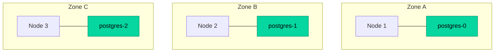
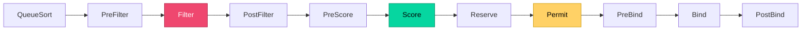
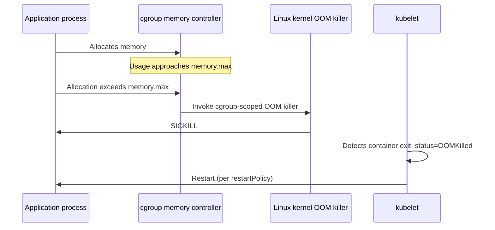
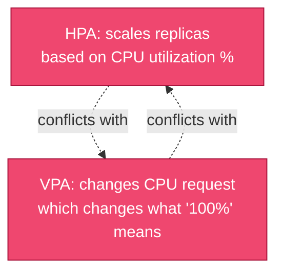
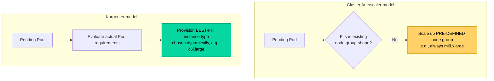

# Part 6: Scheduling and Resource Management

> **Prerequisite**: Part 2.1.3 (scheduler filter/score model), Part 3.1.3 (QoS classes), Part 3.5 (PodDisruptionBudgets).
> **Goal**: Be able to deliberately steer where workloads run and how the cluster scales, with a precise understanding of failure/tradeoff scenarios.

---

## 6.1 Scheduling Mechanics

### 6.1.1 Node Affinity/Anti-Affinity, Pod Affinity/Anti-Affinity

**Node affinity** constrains which nodes a Pod can land on, based on **node labels** — a more expressive successor to the older `nodeSelector` field (which still works but only supports simple equality matching).

```yaml
affinity:
  nodeAffinity:
    requiredDuringSchedulingIgnoredDuringExecution:    # HARD constraint
      nodeSelectorTerms:
        - matchExpressions:
            - key: node.kubernetes.io/instance-type
              operator: In
              values: ["m6i.xlarge", "m6i.2xlarge"]
    preferredDuringSchedulingIgnoredDuringExecution:   # SOFT preference, weighted
      - weight: 80
        preference:
          matchExpressions:
            - key: topology.kubernetes.io/zone
              operator: In
              values: ["us-east-1a"]
```

The naming is verbose but precise: `requiredDuringScheduling` means it's a hard filter (Pod won't schedule at all if unsatisfiable); `IgnoredDuringExecution` means once the Pod *is* running, Kubernetes does **not** evict/reschedule it even if the node's labels later change and no longer satisfy the rule. (A `requiredDuringExecution` variant doesn't exist in GA Kubernetes — node affinity has never enforced eviction on label drift; this is a deliberate stability-over-strictness design choice.)

**Pod affinity/anti-affinity** constrains placement *relative to other Pods*, rather than to static node labels:

```yaml
affinity:
  podAntiAffinity:
    requiredDuringSchedulingIgnoredDuringExecution:
      - labelSelector:
          matchLabels:
            app: postgres
        topologyKey: kubernetes.io/hostname    # never co-locate 2 postgres pods on the SAME node
  podAffinity:
    preferredDuringSchedulingIgnoredDuringExecution:
      - weight: 100
        podAffinityTerm:
          labelSelector:
            matchLabels:
              app: backend
          topologyKey: topology.kubernetes.io/zone   # prefer being in the same zone as backend pods
```

`topologyKey` is the key conceptual piece: anti-affinity isn't "never on the same node" by definition — it's "never within the same value of *this label*." Using `kubernetes.io/hostname` means per-node uniqueness; using `topology.kubernetes.io/zone` means per-availability-zone spreading, a critical pattern for genuine HA (placing all 3 database replicas in different *zones*, not just different nodes that could still share the same zone's failure domain).



**Performance caveat**: `podAffinity`/`podAntiAffinity` (unlike node affinity) require the scheduler to examine *other Pods'* labels across the cluster, which is computationally more expensive — at very large cluster scale (thousands of nodes), heavy use of required pod anti-affinity can measurably slow scheduling throughput. This is rarely a concern at typical scale but worth knowing as a tail-risk.

### 6.1.2 Taints and Tolerations

Where affinity is a **Pod-driven "pull"** mechanism (Pod expresses where it wants to go), taints/tolerations are a **Node-driven "push" mechanism** (Node expresses what it refuses to accept, unless a Pod explicitly tolerates it).

```bash
kubectl taint nodes node-1 dedicated=gpu-workloads:NoSchedule
```

```yaml
# Only Pods with this exact toleration can schedule onto node-1
tolerations:
  - key: "dedicated"
    operator: "Equal"
    value: "gpu-workloads"
    effect: "NoSchedule"
```

Three taint effects, increasing in severity:

| Effect | Behavior |
|---|---|
| `NoSchedule` | New Pods without a matching toleration won't be scheduled here; **existing** Pods already running are unaffected |
| `PreferNoSchedule` | Soft version — scheduler tries to avoid it, but will place Pods here if no better option exists |
| `NoExecute` | New Pods won't schedule **and existing Pods without the toleration are evicted** — the only taint effect with active eviction behavior |

```yaml
tolerations:
  - key: "node.kubernetes.io/not-ready"
    operator: "Exists"
    effect: "NoExecute"
    tolerationSeconds: 300    # tolerate a NotReady node for up to 5 min before eviction, not indefinitely
```

This `NoExecute` + `tolerationSeconds` pattern is actually how Kubernetes implements its **own** automatic Pod eviction from failed nodes — every Pod gets a default, automatically-added toleration for `node.kubernetes.io/not-ready` and `node.kubernetes.io/unreachable` with a default `tolerationSeconds` (300s), which is the actual underlying mechanism behind the `pod-eviction-timeout` behavior mentioned in Part 2.2.1.

**Standard production use case**: dedicating expensive nodes (GPU instances, for example) exclusively to the workloads that need them, preventing general-purpose workloads from accidentally consuming expensive capacity:

```bash
kubectl taint nodes gpu-node-1 nvidia.com/gpu=true:NoSchedule
# Only Pods explicitly requesting GPU resources AND tolerating this taint will land here
```

### 6.1.3 Topology Spread Constraints

Affinity/anti-affinity express binary relationships ("with" or "not with"); **topology spread constraints** express a *distribution* goal — "spread my Pods evenly across this topology dimension" — which anti-affinity can't cleanly express for more than 2 replicas.

```yaml
topologySpreadConstraints:
  - maxSkew: 1                          # max difference in pod count between any two topology domains
    topologyKey: topology.kubernetes.io/zone
    whenUnsatisfiable: DoNotSchedule    # DoNotSchedule (hard) | ScheduleAnyway (soft)
    labelSelector:
      matchLabels:
        app: backend
```

`maxSkew: 1` with 3 zones and 9 replicas means each zone gets 3 (skew 0); with 10 replicas, the distribution would be 4/3/3 (skew 1) — never 8/1/1. This is the modern, more precise replacement for "just use anti-affinity and hope" when spreading more than a small number of replicas, and is commonly combined *with* pod anti-affinity for layered guarantees (e.g., "spread across zones evenly, AND never co-locate on the exact same node").

### 6.1.4 Scheduler Extension Points and Scheduling Framework

For scheduling logic that the built-in filter/score plugins can't express (Part 2.1.3 introduced this two-phase model), the **Scheduling Framework** exposes extension points where custom plugins can hook in, without forking the scheduler itself:



Custom scheduler plugins (compiled into a custom scheduler binary, or run as a second scheduler via `schedulerName`) are used for advanced cases: gang scheduling for ML training jobs (all-or-nothing placement of a batch of Pods, relevant to Part 19's AI workload serving), cost-aware bin-packing strategies, or custom multi-tenancy fairness logic beyond what `ResourceQuota` alone provides. Most platform teams will **consume** an existing custom scheduler (e.g., the Kubernetes scheduler plugins repository, or a vendor's gang scheduler for GPU workloads) rather than writing one from scratch — but understanding these extension points clarifies what's actually possible versus what requires an entirely different tool.

---

## 6.2 Resource Governance

### 6.2.1 Requests, Limits, and the OOMKiller Relationship

Already introduced in Part 3.1.3. Worth reinforcing the precise mechanics of what happens when a container exceeds its memory limit:



Critically, this is a **cgroup-scoped** OOM kill, not a node-wide one — only the offending container is killed, not the entire node or other Pods (assuming the node itself isn't *also* under genuine memory pressure, which is the separate node-level eviction scenario covered next). This distinction matters for diagnosis: `kubectl describe pod` showing `OOMKilled` with a specific exit code (137 = `SIGKILL`) is a **container-limit** event; node-level `MemoryPressure` evictions (Part 6.2.3) are a different mechanism entirely, triggered by the kubelet's own eviction manager, not the kernel cgroup OOM killer.

### 6.2.2 LimitRanges and ResourceQuotas

**LimitRange**: enforces *default* and *min/max bounds* on individual Pod/container resource requests within a namespace — protects against the common mistake of forgetting to set requests/limits at all (which produces a `BestEffort` QoS Pod, Part 3.1.3, with zero protection under pressure).

```yaml
apiVersion: v1
kind: LimitRange
metadata:
  name: default-limits
  namespace: production
spec:
  limits:
    - type: Container
      default:                 # applied if a container doesn't specify limits
        cpu: "500m"
        memory: "512Mi"
      defaultRequest:          # applied if a container doesn't specify requests
        cpu: "100m"
        memory: "128Mi"
      max:                      # hard ceiling — Pods requesting more are REJECTED at admission
        cpu: "4"
        memory: "8Gi"
      min:
        cpu: "50m"
        memory: "64Mi"
```

**ResourceQuota**: enforces *aggregate* limits across an entire namespace — total CPU/memory requested, total object counts (Pods, Services, PVCs), preventing one team/namespace from consuming an unfair share of cluster capacity.

```yaml
apiVersion: v1
kind: ResourceQuota
metadata:
  name: team-a-quota
  namespace: team-a
spec:
  hard:
    requests.cpu: "20"
    requests.memory: 40Gi
    limits.cpu: "40"
    limits.memory: 80Gi
    persistentvolumeclaims: "10"
    pods: "50"
```

**Critical interaction**: once a `ResourceQuota` exists in a namespace covering CPU/memory, **every Pod in that namespace must specify explicit requests/limits**, or its creation is rejected outright — there's no implicit default unless a `LimitRange` is *also* present to supply one. This combination (`ResourceQuota` + `LimitRange` together) is the standard production multi-tenancy pattern (revisited in Part 15.3), and deploying a `ResourceQuota` without a corresponding `LimitRange` is a common cause of confusing "why is my Deployment suddenly failing to create Pods" incidents after a quota rollout.

### 6.2.3 Priority Classes and Preemption

```yaml
apiVersion: scheduling.k8s.io/v1
kind: PriorityClass
metadata:
  name: high-priority-critical
value: 1000000
globalDefault: false
description: "Reserved for critical production workloads"
---
apiVersion: scheduling.k8s.io/v1
kind: PriorityClass
metadata:
  name: low-priority-batch
value: 100
globalDefault: false
```

```yaml
spec:
  priorityClassName: high-priority-critical
```

When a high-priority Pod cannot be scheduled due to insufficient resources, the scheduler can **preempt** (evict) lower-priority Pods on a node to make room — a hard guarantee that critical workloads get capacity even under cluster-wide resource pressure, at the cost of potentially disrupting lower-priority work. This is the mechanism behind reserving guaranteed capacity for, e.g., production-critical services over best-effort batch/dev workloads sharing the same cluster.

**System-critical priority classes** (`system-cluster-critical`, `system-node-critical`) are reserved for core cluster infrastructure (CoreDNS, CNI components) and should never be used for regular application workloads — doing so undermines the entire point of having a reserved tier for genuinely cluster-critical infrastructure.

### 6.2.4 Quality of Service Deep Dive: Eviction Order Under Node Pressure

Revisiting Part 3.1.3's QoS table with the actual kubelet eviction mechanics: the kubelet's **eviction manager** continuously monitors node-level signals (`memory.available`, `nodefs.available`, `imagefs.available`, `pid.available`) against configured eviction thresholds, independent of and prior to any individual container hitting its own cgroup limit.

```yaml
# kubelet configuration (not a Kubernetes object — a kubelet flag/config file setting)
evictionHard:
  memory.available: "200Mi"
  nodefs.available: "10%"
evictionSoft:
  memory.available: "500Mi"
evictionSoftGracePeriod:
  memory.available: "1m30s"
```

When a **hard** eviction threshold is crossed, the kubelet begins evicting Pods **immediately**, in this order: `BestEffort` first, then `Burstable` Pods using more than their *requested* memory (ranked by how far over their request they are), and only as an absolute last resort, `Guaranteed` Pods. A **soft** threshold (crossed for longer than its grace period) triggers the same eviction logic but with a grace period buffer, giving transient pressure a chance to resolve on its own first.

This is precisely why setting accurate memory **requests** (not just limits) matters even for workloads that rarely hit their limit — under-requesting memory (setting a request far below typical usage) makes a Pod look artificially "over its request" during pressure, making it a more likely eviction candidate even if its actual usage is reasonable relative to the node's true capacity.

---

## 6.3 Autoscaling

### 6.3.1 Horizontal Pod Autoscaler (HPA): Metrics-Based Scaling

```yaml
apiVersion: autoscaling/v2
kind: HorizontalPodAutoscaler
metadata:
  name: backend-hpa
spec:
  scaleTargetRef:
    apiVersion: apps/v1
    kind: Deployment
    name: backend
  minReplicas: 3
  maxReplicas: 20
  metrics:
    - type: Resource
      resource:
        name: cpu
        target:
          type: Utilization
          averageUtilization: 70
    - type: Pods
      pods:
        metric:
          name: http_requests_per_second
        target:
          type: AverageValue
          averageValue: "1000"
  behavior:
    scaleDown:
      stabilizationWindowSeconds: 300   # wait 5 min of sustained low usage before scaling down
      policies:
        - type: Pods
          value: 2
          periodSeconds: 60              # scale down by at most 2 pods per minute
    scaleUp:
      stabilizationWindowSeconds: 0      # scale up immediately, no debounce
      policies:
        - type: Percent
          value: 100
          periodSeconds: 30              # can double pod count every 30s if needed
```

The HPA controller polls the **metrics pipeline** (the standard `metrics-server` for basic CPU/memory, or the **Custom Metrics API**/**External Metrics API** for anything else — Prometheus Adapter is the common bridge for Prometheus-sourced metrics) every sync period (default 15s) and computes desired replica count via:

```
desiredReplicas = ceil(currentReplicas × (currentMetricValue / desiredMetricValue))
```

**`behavior.scaleDown.stabilizationWindowSeconds`** is one of the most operationally important and most-overlooked HPA settings — without it, an HPA reacting to a brief dip in load will scale down aggressively, then scale back up moments later when load returns, causing **flapping** (continuous churn of Pod creation/destruction) that's both wasteful and can degrade availability during the scale-up lag. A 5-minute stabilization window is a common, reasonable starting default for most workloads.

### 6.3.2 Vertical Pod Autoscaler (VPA)

Where HPA changes *replica count*, VPA changes a Pod's **resource requests/limits** automatically, based on observed historical usage — useful for right-sizing workloads whose resource needs aren't well known upfront, or that drift over time.

```yaml
apiVersion: autoscaling.k8s.io/v1
kind: VerticalPodAutoscaler
metadata:
  name: backend-vpa
spec:
  targetRef:
    apiVersion: apps/v1
    kind: Deployment
    name: backend
  updatePolicy:
    updateMode: "Auto"    # Off (recommendation-only) | Initial | Recreate | Auto
  resourcePolicy:
    containerPolicies:
      - containerName: "*"
        minAllowed:
          cpu: "100m"
          memory: "128Mi"
        maxAllowed:
          cpu: "2"
          memory: "4Gi"
```

`updateMode: "Off"` is the safest starting point in production — VPA computes and exposes its recommendations (visible via `kubectl describe vpa`) **without actually applying them**, letting a human review and manually adjust requests/limits based on VPA's analysis. `updateMode: "Auto"` actually **evicts and recreates** Pods to apply new resource values (there is currently no way to resize a running container's cgroup limits in-place via VPA in most setups, though **in-place Pod resize**, GA-track as of recent Kubernetes versions, is changing this — see note below), which is itself a voluntary disruption subject to PodDisruptionBudgets (Part 3.5).

**In-place Pod resize** (a newer, separately-evolving Kubernetes feature, not VPA-specific): allows updating `resources.requests`/`resources.limits` on a *running* Pod without restarting the container at all, for resizable resource types. This is gradually changing how VPA's `Auto` mode operates (avoiding the disruptive evict-and-recreate cycle), but adoption depends on container runtime and resource-type support — worth checking current cluster/Kubernetes-version support rather than assuming it's universally available.

### 6.3.3 VPA + HPA Conflicts and Resolution Strategies

Running VPA and HPA **on the same metric simultaneously is explicitly unsupported and will conflict**: if VPA increases a Pod's CPU *request* while HPA is scaling replica count based on CPU *utilization* (which is calculated relative to the request), the two controllers fight — VPA's request change shifts the utilization percentage HPA is reacting to, causing oscillation.



**Safe combination pattern**: use VPA on a **different metric dimension** than HPA — e.g., VPA manages memory requests/limits (right-sizing for memory footprint) while HPA scales on CPU utilization or a custom application metric (requests-per-second). Alternatively, use VPA in `updateMode: "Off"` purely for **recommendations** that inform manually-set static requests, while HPA handles all live scaling — the most common, lowest-risk production pattern.

### 6.3.4 Cluster Autoscaling: Cluster Autoscaler vs Karpenter

Pod-level autoscaling (HPA/VPA) only helps if the cluster actually has enough **node** capacity to schedule the resulting Pods. **Cluster-level autoscaling** adds/removes nodes based on scheduling pressure.

**Cluster Autoscaler (CA)**: works in terms of **node groups/pools** (pre-defined, fixed-shape groups of identical instance types, e.g., an AWS Auto Scaling Group). When Pods are unschedulable due to insufficient capacity, CA scales up a node group; when nodes are underutilized for a sustained period, it scales them down (respecting PodDisruptionBudgets during the drain, Part 3.5.3).

**Karpenter**: a newer, more flexible alternative that does **not** require pre-defined node groups — it provisions nodes directly (calling the cloud provider's instance API) with whatever instance type/size best fits the *actual pending Pods'* resource requirements, evaluated in real time.

```yaml
apiVersion: karpenter.sh/v1
kind: NodePool
metadata:
  name: general-purpose
spec:
  template:
    spec:
      requirements:
        - key: kubernetes.io/arch
          operator: In
          values: ["amd64"]
        - key: karpenter.sh/capacity-type
          operator: In
          values: ["spot", "on-demand"]
        - key: node.kubernetes.io/instance-category
          operator: In
          values: ["m", "c", "r"]
      nodeClassRef:
        group: karpenter.k8s.aws
        kind: EC2NodeClass
        name: default
  limits:
    cpu: "1000"
  disruption:
    consolidationPolicy: WhenEmptyOrUnderutilized
    consolidateAfter: 30s
```



**Key Karpenter capability**: `consolidationPolicy: WhenEmptyOrUnderutilized` actively looks for opportunities to **replace** a set of underutilized nodes with fewer, better-fitting ones (not just scaling down empty nodes), continuously optimizing bin-packing — directly relevant to the cost-management material in Part 17.2. This consolidation is itself a voluntary disruption and is fully governed by PodDisruptionBudgets, which is precisely why the PDB pitfalls covered in Part 3.5.4 (especially the "minAvailable blocks all disruption" trap) become operationally critical the moment Karpenter consolidation is enabled — a misconfigured PDB silently prevents cost-saving consolidation from ever happening, with no error surfaced unless you're specifically watching Karpenter's logs/events.

### 6.3.5 Custom Metrics and KEDA for Event-Driven Scaling

HPA's native support is CPU/memory plus, via adapters, any metric exposed through the Custom/External Metrics APIs — but configuring Prometheus Adapter for this is notoriously fiddly. **KEDA (Kubernetes Event-Driven Autoscaling)** simplifies this dramatically and adds **scale-to-zero** capability (which HPA alone cannot do — HPA's `minReplicas` cannot be 0), built around the concept of **Scalers** for dozens of event sources (Kafka lag, SQS queue depth, Prometheus queries, cron schedules, and many more).

```yaml
apiVersion: keda.sh/v1alpha1
kind: ScaledObject
metadata:
  name: kafka-consumer-scaler
spec:
  scaleTargetRef:
    name: kafka-consumer-deployment
  minReplicaCount: 0          # scale-to-zero — impossible with native HPA alone
  maxReplicaCount: 50
  cooldownPeriod: 300
  triggers:
    - type: kafka
      metadata:
        bootstrapServers: kafka-broker.kafka.svc:9092
        consumerGroup: my-consumer-group
        topic: events
        lagThreshold: "100"
```

Under the hood, **KEDA actually creates and manages a standard HPA object** for you (when scaling above 0) — it's not a replacement for HPA but a metrics-source abstraction layer plus the scale-to-zero capability that sits in front of it. For event-driven workloads (queue consumers, especially relevant if `sre-bot`'s Kafka pipeline ever needs consumer auto-scaling based on consumer lag rather than fixed replica counts), KEDA is generally the more direct path than hand-configuring Prometheus Adapter custom metrics.

### 6.3.6 Scaling Cold-Start Tradeoffs (Overprovisioning, Pause Pods)

Cluster-level autoscaling (CA/Karpenter) has an inherent **latency cost**: provisioning a brand-new cloud instance, having it join the cluster, and become `Ready` typically takes anywhere from 30 seconds to several minutes depending on cloud/instance type — far slower than HPA's Pod-level scaling reaction time. For latency-sensitive workloads experiencing sudden traffic spikes, this gap can mean real user-facing impact while new node capacity comes online.

The standard mitigation is **overprovisioning via low-priority "pause Pods"**:

```yaml
apiVersion: apps/v1
kind: Deployment
metadata:
  name: overprovisioning-pause
spec:
  replicas: 5
  template:
    spec:
      priorityClassName: lowest-priority    # see 6.2.3 — must be lower priority than real workloads
      containers:
        - name: pause
          image: registry.k8s.io/pause:3.9
          resources:
            requests:
              cpu: "1"
              memory: "2Gi"
```

These Pods consume no real resources (the `pause` image does nothing) but **reserve capacity headroom** by occupying schedulable space — when a real, higher-priority Pod needs to schedule and there's no room, the scheduler **preempts** (evicts) these low-priority pause Pods first (Part 6.2.3), making the real Pod schedule *immediately* using already-provisioned node capacity, while the now-evicted pause Pods become newly-pending themselves and trigger the *slower* cluster-autoscaler scale-up in the background to restore the buffer. This trades a small amount of constant "wasted" reserved capacity for near-zero-latency absorption of sudden spikes.

---

## Summary: What You Should Take Away From Part 6

- Affinity is Pod-driven "pull," taints/tolerations are Node-driven "push" — understanding this distinction clarifies which mechanism fits a given placement requirement.
- Topology spread constraints express even *distribution* goals that simple anti-affinity can't cleanly handle beyond 2 replicas, and are commonly layered with anti-affinity for combined zone+node guarantees.
- `NoExecute` is the only taint effect with active eviction behavior, and is the actual mechanism underlying Kubernetes' own node-failure Pod eviction (`tolerationSeconds`).
- LimitRange supplies defaults; ResourceQuota enforces aggregate ceilings — deploying a ResourceQuota without a LimitRange is a common cause of confusing Pod-creation rejections.
- Memory limit violations trigger a cgroup-scoped kernel OOM kill; node-level memory pressure triggers a *separate* kubelet eviction-manager mechanism — these are easy to conflate but operate at different layers.
- VPA and HPA must never act on the same metric simultaneously; the safe pattern is either different metric dimensions or VPA in recommendation-only mode.
- Karpenter's flexible, real-time-fit provisioning model is a meaningful architectural departure from Cluster Autoscaler's fixed-node-group model, and its consolidation behavior makes correct PodDisruptionBudget configuration operationally critical, not optional.
- KEDA's main value-adds over raw HPA are scale-to-zero and a far simpler event-source abstraction — it still creates a standard HPA under the hood.
- Cluster-level scaling latency is real and matters for spike-sensitive workloads; low-priority pause-Pod overprovisioning is the standard mitigation pattern.


